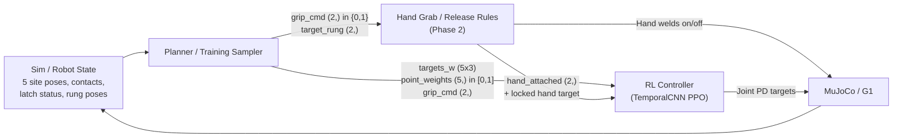

# Planner / Controller Climbing Development Plan

## Goal & Architecture

Transition ladder climbing from single-reset static body-point reaching (`body-targets`) into a two-layer **Planner + Whole-Body RL Controller** system:

- **Planner (High-Level):** Chooses *which* limb moves, *where* each point goes, *how stiffly* each point is penalized (`point_weights` $\in [0, 1]^5$), and *when* each hand grabs (`1`) or lets go (`0`) of a rung.
- **Hand Grab/Release Layer (Simulator / Hardware):** Turns the planner's `grip_cmd` (`1` = grab, `0` = let go) into hand welds in simulation and finger open/close commands on hardware.
- **Controller (RL Policy):** A planner-agnostic whole-body servo that observes 5-point targets, **continuous per-point penalty weights**, **hand latch status & grip commands** (added in Phase 2 alongside multi-pose generation), proprioception, and 14-rung torso-frame geometry.

### Core Design Choices

1. **Keep the 5 Tracked Body Points (`left_hand`, `right_hand`, `left_foot`, `right_foot`, `head`):**
   - Extremities define ladder contacts while `head_site` (`+0.43 m` on `torso_link`) guides upper-body lean and height.
   - Waist, pelvis, knees, and elbows stay free so PPO resolves shin-vs-rung clearance and whole-body balance automatically under OmniRetarget mesh collisions.
2. **Continuous 5-Point Penalty Weights (`point_weights` $w_i \in [0, 1]^5$):**
   - Replaces the rigid `one_hot(5)` indicator with a smooth stiffness dial:
     - $w_i = 1.0$: firm stance contact or final rung placement.
     - $w_i \approx 0.4\text{--}0.6$: compliant mid-air clearance via-point around a box rung.
     - $w_{\text{head}} \approx 0.10\text{--}0.25$: soft torso tether that yields easily when the controller needs an $8\text{--}10\text{ cm}$ CoM shift to lift a leg, while gently preventing torso twist or drift.
     - $w_i = 0.0$: completely unconstrained point.
3. **Stage Weighting First (Phase 1), Then Poses + Hand Grabbing Together (Phase 2):**
   - Phase 1 changes **only** target weighting, sampling, and mid-episode target updates—leaving grip action dimensions, weld-off behavior, and the keyframe reset pose untouched so every change is exercised immediately.
   - Hand grab/release rules and latch observations are introduced in Phase 2 *together* with LLM-generated latched and unlatched poses, where single-hand hangs, mid-air reaches, and releases immediately test every grab/release path.

---

## Phase 1 — Continuous 5-Point Penalty Weights & Chained Subgoals (Welds Off)

**Objective:** Replace `one_hot(5)` with continuous `point_weights` $w_i \in [0, 1]^5$, add in-episode target transitions, and leave all grip/weld behavior, action dimensions, and the keyframe reset pose unchanged (`latches_enabled = False`, `31D` actions, `35D` command). Resets stay on `LADDER_INITIAL_POSE`. Targets, errors, and rewards are torso-frame distances on a constant-slope ladder, so translating the body by whole rungs does not change the tracking problem.

### 1. Continuous `point_weights` in `BodyPointTargetCommand` (`train_mimic/tasks/tracking/mdp/body_targets.py`)
- Store `self.point_weights: torch.Tensor` of shape `(E, 5)` (`float32`, clamped to `[0.0, 1.0]`).
- Keep `command` at **`35D`** (exact same shape as today, swapping `one_hot(5)` for `point_weights(5)`):
  - `point_weights`: `5D` ($w_i \in [0.0, 1.0]$)
  - `targets_torso`: `15D` (torso-frame target coordinates; substituted with `points_torso` only when `point_weights[i] == 0.0`)
  - `errors_torso`: `15D` (**unscaled** torso-frame `targets_torso - points_torso`, zeroed only when `point_weights[i] == 0.0` so the policy distinguishes "20 cm away at weight 0.1" from "2 cm away at weight 1.0")
- Keep `critic_privileged` at **`6D`**: raw per-point distances (`5D`) and weighted distance sum $\sum_i w_i d_i$ (`1D`).
- Leave `actions` (`29` joints + `2` unused grip dims = `31D`) and `_force_welds_off()` untouched.

### 2. Spike-Free Weighted Rewards (`body_targets.py`)
- **`target_pos`:** Weighted Euclidean distance sum
  $$d_{\mathbf{w}} = \sum_{i=0}^{4} w_i \|\mathbf{p}_i - \mathbf{p}_i^*\|$$
  with rate `1.25 - min(d_w, 1.0)` (`0.0` on ground contact).
- **`target_gain`:** Track per-point `_point_dist_prev: (E, 5)` and `_point_valid: (E, 5)`.
  - Set `_point_valid[e, i] = False` on env reset, whenever point $i$'s target is reassigned, or when `point_weights[e, i]` was `0.0` on the prior step.
  - Put $w_i$ **outside** the step difference:
    $$g_{\mathbf{w}} = \frac{\text{TARGET\_GAIN\_SCALE}}{\Delta t} \sum_{i=0}^{4} w_i \, \mathbb{I}[\text{valid}_i] \big(d_{i,\text{prev}} - d_{i,\text{curr}}\big)$$
    (`0.0` on ground contact), so changing `point_weights` mid-episode on a stationary body produces **zero** fake reward spike.

### 3. Sampling & Mid-Episode Chaining (`body_targets.py`, `env.py`)
- Increase `TARGET_BALL_RADIUS_M` from `0.20` to **`0.25`** so full 1-rung steps ($\approx 0.1994\text{ m}$) sit comfortably inside the ball.
- **Anchor-Biased Continuous Weight Sampler (`sample_point_weights`):**
  1. Draw all 4 limb weights high by default: $w_{\text{limbs}} \sim \text{Uniform}(0.75, 1.0)$.
  2. With $50\%$ probability per env, pick 1 limb $k$ and soften its weight to $w_k \sim \text{Uniform}(0.05, 0.75)$ (covering compliant swing and clearance via-point regimes while keeping at least 3 limbs firmly anchored).
  3. Draw `head` weight from a soft-tether-biased mixture: $70\%$ from $\text{Uniform}(0.05, 0.35)$, $25\%$ from $\text{Uniform}(0.35, 1.0)$, and $5\%$ at `0.0`.
- **Keyframe Reset:** Keep writing `LADDER_INITIAL_POSE` with no rung offset.
- **In-Episode Chained Subgoals:** Increase `episode_length_s` to **`8.0`** seconds and sample a new target + weight vector mid-episode (without resetting physics or CNN history) when firm points ($w_i \ge 0.5$) stay within `0.035 m` for `12` steps (`0.24 s`) or when a `1.5–2.0 s` subgoal timer expires.
- **Viser Debug Visualization:** Scale target sphere opacity with `point_weights` (hide at `0.0`) and display the 5 weights in the Viser `"Body targets"` panel.
- Bump `LADDER_CODE_VERSION` to `"weighted-body-targets"`.

### Phase 1 Verification Gate
- Unit tests in `tests/test_body_targets.py` and `tests/test_ladder_training.py` verify weighted `target_pos` / `target_gain`, zero gain impulse on mid-episode weight or target changes, and unchanged `35D` command / `31D` action shapes.
- Viser check confirms single-leg and single-arm moves under soft `head` weight (`~0.15`) shift the torso naturally without falling.

---

## Phase 2 — LLM Latched/Unlatched Pose Bank + Hand Grab/Release Rules

**Objective:** Introduce diverse LLM-generated initial poses (`(0,0)`, `(1,0)`, `(0,1)`, `(1,1)` latched states) **together** with the hand grab/release weld rules and latch observations, so every grab, hold, and release path is immediately exercised and debuggable across real climbing postures.

### 1. Extend `LadderPose` & Build LLM Pose Pipeline (`ladder_init.py`, `scripts/dev/validate_ladder_poses.py`)
- Extend `LadderPose` with `latched: tuple[bool, bool] = (False, False)` (`(left_hand, right_hand)`) and `name: str = ""`.
- **LLM Pose Synthesis (e.g., GPT6 Astra):**
  - Provide ladder geometry ($69.4^\circ$ slope, rung coordinates, $11\text{ cm} \times 7\text{ cm}$ treads, $0.70\text{ m}$ rail width), G1 29-DoF joint limits, hand/foot site offsets, and `LADDER_INITIAL_POSE`.
  - Generate candidate poses across all four latch combinations `(False, False)`, `(True, False)`, `(False, True)`, `(True, True)`:
    1. Symmetric stances (crouched, neutral, extended arms, leaned-in unlatched friction stances, leaned-back welded hangs).
    2. Staggered hand-advance poses (one hand latched on rung $h$, other hand unlatched mid-reach or latched on $h+1$).
    3. Single-leg lift / high-step poses (stance foot on $f$, swing foot raised toward $f+1$, both with hands latched and unlatched).
    4. Staggered 4-limb poses `(LH=h+1, RH=h+1, LF=f+1, RF=f)`.
- **Automated MuJoCo Pose Validator:**
  - Verify every candidate pose (plus its `left <-> right` mirror) has valid joint limits, zero floor contact, no deep rung/rail mesh penetrations, hands within grab range whenever `pose.latched[h] == True`, and stable 0.5-second PD hold without violent forces or falls.

### 2. Plain-Language Hand Grab/Release Rules (`body_targets.py`)
Enable `latches_enabled = True` in `BodyPointTargetCommand` and track `grip_cmd` (`1` = grab, `0` = let go) and `hand_attached` (`True` = currently welded to a rung, `False` = free) for each hand across all parallel environments:
1. **Reset from a pose:** If `pose.latched[h]` is `True`, lock that hand's weld onto the rung at its starting pose and set `grip_cmd[h] = 1`; otherwise leave the weld off and `grip_cmd[h] = 0`.
2. **Command says `0` (let go):** Turn that hand's weld off immediately so the hand is free to move.
3. **Command says `1` (grab):**
   - If the hand is already welded, keep it welded.
   - If the hand is free, wait until it gets close to the target rung (`<= attach_distance`) and slows down (`<= max_attach_speed`), then turn the weld on **at the exact spot the hand already reached** (so it doesn't get yanked sideways to the center of the bar).
4. **Two edge-case guards:**
   - **No re-grabbing the old rung:** When moving a hand from rung 7 to rung 8, specify `target_rung = 8` so the departing hand cannot accidentally lock right back onto rung 7 before leaving.
   - **Don't ask a glued hand to move:** As soon as a hand locks onto a rung (or while it stays welded), snap its target dot to the exact spot where the hand locked—so the reward never penalizes the robot for a 2–3 cm gap that a welded hand physically cannot close.

### 3. Controller Latch Observations & Sampling (`body_targets.py`, `env.py`)
- **Tell the controller what is happening (`command` `35D -> 39D`):**
  - Append `hand_attached (2D)` and `grip_cmd (2D)` to `command` (`[point_weights(5), hand_attached(2), grip_cmd(2), targets_torso(15), errors_torso(15)]`) so both the MLP and the 10-step Temporal CNN see whether each hand is currently welded or free, and whether it is trying to grab or let go.
  - Append nearest-rung distances (`2D`) to `critic_privileged` (`6D -> 8D`).
  - *(Optional clean-up in Phase 2 since shapes already change from `35D -> 39D`: drop the unused 2D `LadderGripActionCfg` so actions become pure `29D` joint targets, or keep `31D` if desired.)*
- **Latch-consistent target sampling:**
  - Never sample a moving ball target on a hand that stays welded (`hand_attached == 1` and `grip_cmd == 1`).
  - During mid-episode transitions, include **`1 -> 0` let-go moves** (release weld + assign a nearby clearance/reach target) and **`0 -> 1` grab moves** (place hand target on an adjacent rung with `target_rung` set so the controller learns to reach the bar, slow down, and lock on).
- **Viser Latch Readout:** Color hand spheres red when welded and blue when open, alongside the weighted target spheres.
- **External Planner Hook:** Add `set_command(targets_w, point_weights, grip_cmd, target_rung=None, env_ids=None)` so a planner can drive targets, weights, and grab/let-go directly.
- Bump `LADDER_CODE_VERSION` to `"weighted-latch-body-targets"`.

### Phase 2 Verification Gate
- Unit + simulator tests verify all four `(left, right)` latch states at reset, `1 -> 0` immediate release, `0 -> 1` capture without yanking, `target_rung` anti-regrab protection, target snapping upon lock, and pose-bank stability across every LLM-generated pose.

---

## Phase 3 — Train Controller v1 & Validate in Viser

**Objective:** Train the weighted, latch-aware controller across the full LLM pose bank and verify all climbing primitives interactively before writing planner rules.

1. **Full Batched PPO Run (`train_mimic/scripts/train_ladder.py`)**
   - Train with `--num_envs 4096` on `"weighted-latch-body-targets"`.
   - Monitor `Episode_Reward/target_pos`, `Episode_Reward/target_gain`, `Episode_Termination/touched_ground`, firm-point tracking error, and `0 -> 1` rung grab completion rate.
2. **Interactive Viser Evaluation (`play.py` / `scripts/visor.sh`)**
   - Test all four latch states (`(0,0)`, `(1,0)`, `(0,1)`, `(1,1)`), compliant via-point weights (`w ≈ 0.5`), firm contact weights (`w = 1.0`), soft `head` tethering (`w_head ≈ 0.15`), `1 -> 0` releases under load, and `0 -> 1` rung grabs.

### Phase 3 Verification Gate
- Steady-state error `< 0.04 m` on firm points ($w_i \ge 0.75$), reliable rung capture (`> 95%`) on `0 -> 1` commands, and `< 2%` fall rate across 8-second chained episodes.

---

## Phase 4 (Provisional) — Closed-Loop Rung Planner

> *Note: Provisional design—waypoint geometry, weight schedule, and grab/release timing will be tuned once Phase 3 shows what single-step moves Controller v1 handles cleanly.*

**Objective:** Stack a lightweight closed-loop planner on top of `BodyPointTargetCommand.set_command(...)` outputting `(targets_w, point_weights, grip_cmd, target_rung)` to climb multiple rungs continuously.

1. **Planner Module (`train_mimic/tasks/tracking/mdp/ladder_planner.py`)**
   - Default weights: $w = 1.0$ on anchored/landing contacts, $w = 0.5$ on mid-air clearance via-points, and $w_{\text{head}} = 0.15$ at `mean_limb_center + nominal_head_offset`.
   - Nominal 1-rung cycle `(LH=h, RH=h, LF=f, RF=f) -> (h+1, h+1, f+1, f+1)` keeping 3-point support throughout:
     1. **Lead Hand Let Go & Clear:** `grip_cmd = [0, 1]`, `w_LH = 0.5`, pull `LH` slightly back and halfway up (`Δx ≈ -0.07 m`, `Δz ≈ +0.09 m`) to clear the box rung.
     2. **Lead Hand Reach & Grab:** `grip_cmd = [1, 1]`, `target_rung = [h+1, h]`, `w_LH = 1.0`, target rung `h+1`; advance once `LH` locks onto `h+1`.
     3. **Trail Hand Let Go, Clear & Grab:** repeat for `RH` onto rung `h+1` (`grip_cmd: [1, 0] -> [1, 1]`).
     4. **Lead Foot Clear & Place:** keep `grip_cmd = [1, 1]`; arc `LF` past the box rung (`w_LF = 0.5`, `Δx ≈ -0.06 m`) onto the top tread of rung `f+1` (`w_LF = 1.0`, `+0.043 m`); advance on low error + foot contact.
     5. **Trail Foot Clear & Place:** repeat 2-stage arc for `RF` onto rung `f+1`, settle briefly, and advance `(h, f) -> (h+1, f+1)`.
2. **Playback & Video Integration (`play.py`, `record_ladder_video.py`)**
   - Add `--planner` (plus `--target_rungs` and `--unlatched` to compare latched vs friction-only climbing with the same controller).

---

## Phase 5 (Provisional) — Rollout Refinement, Pose Augmentation & Recovery

> *Note: Provisional—scope depends on whether any failure modes show up when running the Phase 4 planner on Controller v1.*

1. **Targeted Pose Augmentation:** Collect bottleneck states from multi-rung planner runs, add refined LLM or settled rollout poses around them to `LADDER_POSE_BANK`, and `--resume` fine-tune Controller v2.
2. **Planner Retry Guards:** Add simple stall recovery (retract `5–10 cm` in `-x` at `w = 0.5` and retry if a hand misses a grab or a foot hooks under a rung for `> 0.6 s`).
3. **Multi-Rung Benchmark:** Measure completion rate, fall rate, and climb speed over seeded 4–6 rung climbs.
