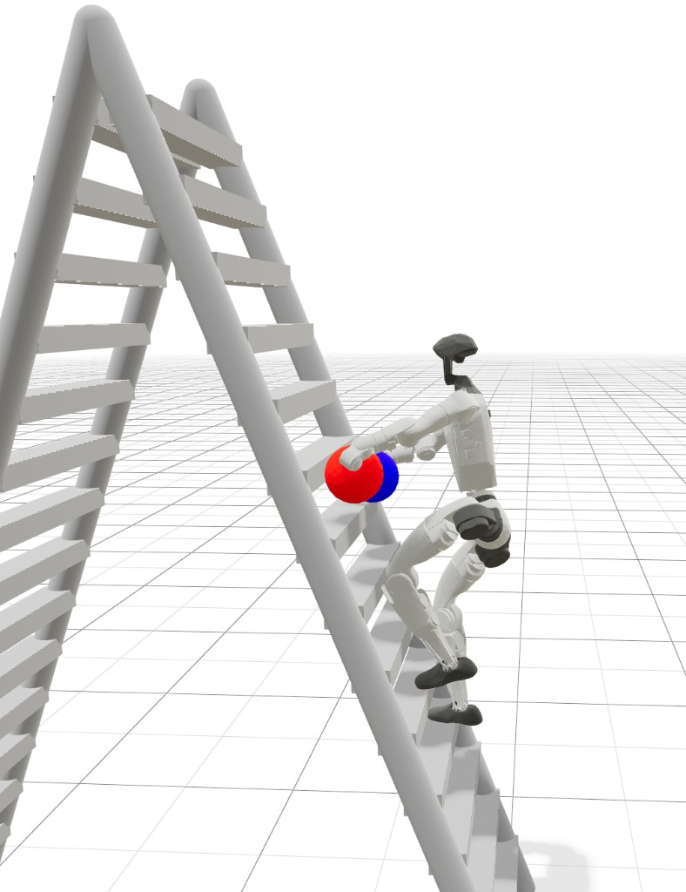
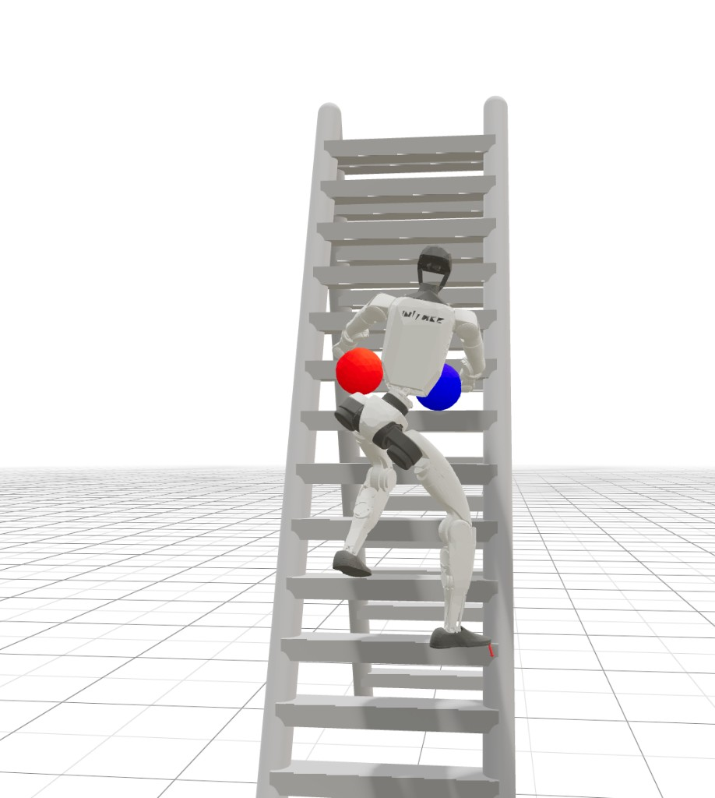

<p align="center">
  
</p>

<h1 align="center">Teleopit</h1>

<p align="center">
  Lightweight, extensible whole-body teleoperation framework for humanoid robots.
  <br/>
  Real-time motion retargeting from BVH / Pico 4 VR to Unitree G1, in MuJoCo sim or on real hardware.
</p>

<p align="center">
  <a href="https://BotRunner64.github.io/Teleopit/">Documentation</a> &bull;
  <a href="https://BotRunner64.github.io/Teleopit/zh-Hans/">中文文档</a> &bull;
  <a href="https://BotRunner64.github.io/Teleopit/tutorials/pico-sim2sim">Pico Sim2Sim</a> &bull;
  <a href="https://BotRunner64.github.io/Teleopit/tutorials/pico-sim2real">Pico Sim2Real</a> &bull;
  <a href="https://BotRunner64.github.io/Teleopit/tutorials/training">Training</a>
</p>

---

## Quick Start — Minimal Sim2Sim

**1. Install**

```bash
pip install -e .
```

**2. Download assets**

```bash
pip install modelscope
python scripts/setup/download_assets.py --only robots gmr ckpt bvh
```

The canonical Unitree G1 robot model is downloaded to
`assets/robots/unitree_g1/g1_29dof.xml`. Training, sim2sim, retargeting, and FK
validation all use this same XML.

**3. Run**

```bash
python scripts/run/run_sim.py \
    controller.policy_path=track.onnx \
    input.bvh_file=data/sample_bvh/aiming1_subject1.bvh
```

You should see a MuJoCo viewer with the robot tracking the BVH motion.

To show the simulated D435i RGB camera view, add the explicit `camera` viewer:

```bash
python scripts/run/run_sim.py \
    controller.policy_path=track.onnx \
    input.bvh_file=data/sample_bvh/aiming1_subject1.bvh \
    'viewers=[sim2sim,camera]'
```

For sim2real, viewers are disabled by default. Add `viewers=retarget` to show
the retargeted reference in an optional MuJoCo window.

## Ladder Climbing

The G1 learns to climb an A-frame ladder from reinforcement learning alone.
There is no motion clip, retarget, or imitation reward. Every episode starts
already on the ladder.

<table>
  <tr>
    <td align="center" width="50%">
      
      <br>
      <sub>Side view. Red is the left hand, blue is the right.</sub>
    </td>
    <td align="center" width="50%">
      
      <br>
      <sub>Climbing face. One foot is coming up to the next rung.</sub>
    </td>
  </tr>
</table>

### Train

```bash
pip install -e '.[train]'
python scripts/setup/install_climb_assets.py
python train_mimic/scripts/train_ladder.py \
    --num_envs 4096 \
    --max_iterations 60000
```

A short check is `--num_envs 64 --max_iterations 100`. Several GPUs on one
machine can be launched with `--gpu_ids 0 1 2 3`. The ladder and the hand
welds are added on top of `assets/robots/unitree_g1/g1_29dof.xml`, so no
separate robot file or motion dataset is required. Checkpoints land in
`logs/rsl_rl/g1_ladder_rl/`.

The train extra pins PyTorch 2.7.1 for CUDA 11.8 on Linux x86_64, from the
Aliyun wheel mirror. That wheel runs on a driver whose newest CUDA is 12.4.
A CUDA 13 wheel leaves `torch.cuda` unavailable there, and training falls
back to CPU. It also pins `warp-lang==1.15.0`. Warp 1.16.0 fails to compile
sensor kernels against `mjlab==1.4.0` / MuJoCo Warp 3.8 (`Referencing
undefined symbol: xmat`), often on a four-process cold start. If an existing
environment has the wrong Warp:

```bash
python -m pip install --force-reinstall "warp-lang==1.15.0"
python -c "import warp as wp; print(wp.__version__)"
```

### What the robot is learning

Both faces of the ladder have solid side rails and flat rungs. The robot
cannot pass through a rail or a rung, and the gap between rungs is empty.
Feet stand on the flat tops. Hands are the red and blue spheres in the
pictures; a hand can weld to a rung once it is close enough.

The start pose puts the feet on rung 3 and the hands on rung 7, counting
from the bottom at 0. From there the skill is the same every time: move
both feet and both hands up exactly one rung, then hold still. The policy
picks the order. After four successful holds the episode ends. Touching
the ground also ends it. Otherwise it times out at 20 seconds.

Gravity in this task is one third of normal, so early attempts can stay on
the ladder long enough to learn the step. Shoulder, elbow, and wrist torque
limits are 70% of the usual G1 values (`25` Nm becomes `17.5`, `5` Nm
becomes `3.5`). Tracking and hardware inference keep the full limits.

Body collisions for this task use convex parts of the G1 instead of the
coarse primitives. Joints, mass, and the visual meshes stay the same. The
[collision asset guide](docs/docs/tutorials/training.md#ladder-collision-assets)
covers how those parts are built.

### Watch a checkpoint

Play one episode in the viewer:

```bash
python train_mimic/scripts/play.py \
    --task G1-Ladder-Climb-RL \
    --checkpoint logs/rsl_rl/g1_ladder_rl/<run>/model_60000.pt
```

Score a checkpoint without more training. This prints success, failure,
timeout, rung progress, grip, and reach, and does not need a motion dataset:

```bash
python train_mimic/scripts/benchmark_ladder.py \
    --checkpoint logs/rsl_rl/g1_ladder_rl/<run>/model_60000.pt \
    --num_envs 64 \
    --num_eval_steps 5000
```

Add `--num_envs 1 --video --video_length 1000` to also write an MP4 under
`benchmark_results/videos/`.

To record only the rollout, with no metrics or report files:

```bash
python train_mimic/scripts/record_ladder_video.py \
    --checkpoint logs/rsl_rl/g1_ladder_rl/<run>/model_60000.pt \
    --output ladder.mp4 \
    --frames 1000
```

The recorder uses one environment and stops at the first fall, timeout, or
`--frames` limit. The camera is a fixed overview of the climbing face.
Change it with `--camera_azimuth`, `--camera_elevation`,
`--camera_distance`, `--camera_lookat X Y Z`, and `--camera_fovy`.

## Pico Motion Recording

Record many Pico clips as training-ready G1 motion NPZ files:

```bash
pip install -e '.[pico4]'
python scripts/run/record_pico_motion.py
```

The recorder starts the Pico receiver and live Retarget viewer before waiting
for clip names, so preview keeps running while the terminal is idle. Enter a
semantic clip name, then use `R` to start, `S` to save, `D` to discard, `N` for
a new name, and `Q` to quit. Saved clips are written to
`data/pico_motion/clips/` using the semantic label in the filename, with no
sidecar JSON.

Merge recorded clips into the standard HDF5 shard dataset:

```bash
python train_mimic/scripts/data/build_dataset.py \
    --spec data/pico_motion/pico_recorded.yaml --force
```

## Sim2Real HDF5 Recording

Pico sim2real can also record manual HDF5 episodes from the real G1:

```bash
pip install -e '.[recording]'
# If you use RealSense video, install pyrealsense2 manually for your platform.
# On Arm machines, prefer conda-forge:
# conda install -c conda-forge pyrealsense2
python scripts/run/run_sim2real.py --config-name sim2real_record \
    controller.policy_path=track.onnx \
    recording.task="walk forward"
```

Recording uses the terminal controls `R` start, `S` save, `D` discard, and `Q`
shutdown. `STANDING`, `MOCAP`, `ARMS`, and paused mocap can be recorded. Saved
episodes are written as `.h5` files under `data/recordings/sim2real_hdf5/episodes/`.
`sim2real_record.yaml` stores camera frames as compressed MP4 sidecar files under
`data/recordings/sim2real_hdf5/videos/` and keeps `frame_index` / `timestamp`
sync metadata in the HDF5 episode. The low-dimensional HDF5 schema records
`observation.state(68)`, `observation.mode(1)`, `action(36)` as the aligned
reference qpos sent to the policy path, and `action.hand(12)` as the latest
LinkerHand left/right 6D pose commands.

## Autoresearch

`autoresearch/` is a file-backed controller for repository tasks. It invokes Cursor CLI, runs the configured validation commands, and commits the result on the `autoresearch` branch. Usage, including task restart and the `cursor-agent` prerequisite, is in [`autoresearch/README.md`](autoresearch/README.md).

```bash
python -m autoresearch.controller new --from-file idea.txt
python -m autoresearch.controller run 0001
python -m autoresearch.controller status
```

## Documentation

Full docs at **[BotRunner64.github.io/Teleopit](https://BotRunner64.github.io/Teleopit/)**, covering installation profiles, all tutorials, configuration reference, and architecture.

## Changelog

### v0.4.0 (2026-06-25)

- Improved Pico realtime control with pico-bridge 0.2.1, `ARMS` mode, armed sim2real mocap entry, and retargeter-preserving pause/arms resets.
- Added optional LinkerHand L6/O6 sim2real control, including Pico gripper input and low-latency L6 `vr_hand_pose`.
- Added manual Pico sim2real HDF5 recording and an interactive Pico motion recorder for training NPZ clips.
- Refined the training data path with minimal HDF5 shards, explicit precompute, rewind sampling, and updated tracking rewards.

### v0.3.0 (2026-05-12)

- Consolidated realtime input around pico-bridge 0.2.0 and removed the old ZMQ/onboard Pico path.
- Unified sim/sim2real reference buffering, resume realignment, and velocity smoothing.
- Added UDP BVH realtime input, online sim config, multi-viewer support, and fixed camera viewing.
- Split sim2real reference/safety runtime modules and updated the G1 MuJoCo camera asset.

### v0.2.0 (2026-04-03)

- Added Pico 4 teleoperation through pico-bridge and the G1 Bridge SDK.
- Added offline playback keyboard controls, Pico sim2sim mode control, and a standalone standing controller.
- Improved realtime mocap buffering/catch-up and upgraded the released model to the 30k checkpoint.

### v0.1.1 (2026-03-28)

- Dataset shard-only refactor
- External asset management (ModelScope), repository slimming

### v0.1.0 (2026-03-25)

- Initial public release: General-Tracking-G1 training, ONNX sim2sim inference, Pico 4 VR teleoperation, Unitree G1 hardware deployment

## License

[Apache 2.0](LICENSE)
