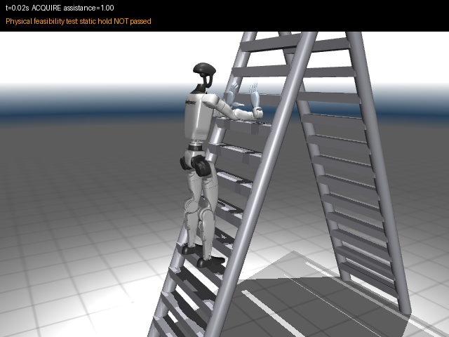
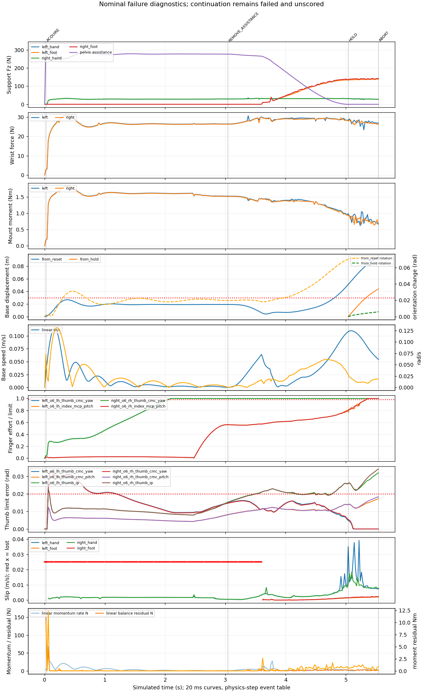
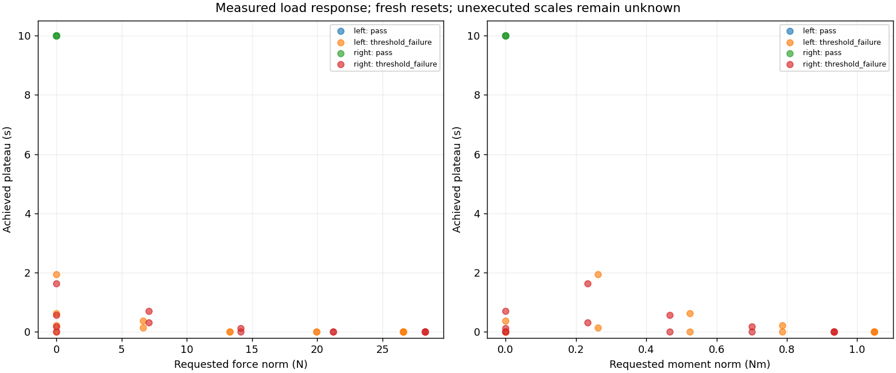

# G1/O6 diagnostic study

The diagnostic experiments are complete. **The prototype still fails unsupported whole-body holding.** Both authentic O6 hands close successfully without a rung and hold the isolated rung under gravity, but none of the tested nonzero wrist loads completes the required plateau. The new thumb-below candidate is available separately; it also fails the original whole-body gates.

This study used CPU MuJoCo in conda `teleopit`, on `dex-hand-exp`. It started from clean `f5c7067fb9e640a17501764df4eaf818679a146d`. The supplied implementation plan defined the diagnostic scope; the user's subsequent request explicitly added the reversed-hand posture experiment. Existing published results, training code, physical parameters, and default standalone behavior were preserved.

## Reproduce

Run from the repository root. Canonical assets must be installed using the existing `scripts/setup/install_climb_assets.py` workflow. NumPy, SciPy, MuJoCo and Matplotlib are present in the tested environment; Matplotlib is imported only for exported figures. Python/MuJoCo versions and exact asset hashes are recorded in every run's resolved metadata.

```powershell
# Original baseline; repeat into a second fresh directory.
conda run --no-capture-output -n teleopit python -m teleopit.sim.g1_o6 --config docs/g1_o6/nominal.json --output outputs/g1_o6/diagnostics/baseline

# Strict diagnostic run and optional failed/unscored continuation.
conda run --no-capture-output -n teleopit python -m teleopit.sim.o6_diagnostics nominal --output outputs/g1_o6/diagnostics/strict
conda run --no-capture-output -n teleopit python -m teleopit.sim.o6_diagnostics nominal --continue-after-failure 3 --output outputs/g1_o6/diagnostics/continued

# Both authoritative hand models; full-hand gravity-on/off tests.
conda run --no-capture-output -n teleopit python -m teleopit.sim.o6_diagnostics free-close --side both --source-run outputs/g1_o6/diagnostics/baseline --output outputs/g1_o6/diagnostics/free_closing

# Signed demands from the reproduced baseline; fresh resets for every case.
conda run --no-capture-output -n teleopit python -m teleopit.sim.o6_diagnostics load-response --side both --source-run outputs/g1_o6/diagnostics/baseline --output outputs/g1_o6/diagnostics/loads

# Reversed posture: thumbs below, fingers above, straighter arms.
conda run --no-capture-output -n teleopit python -m teleopit.sim.g1_o6 --posture thumb-below --viewer --output outputs/g1_o6/diagnostics/thumb_below_viewer
conda run --no-capture-output -n teleopit python -m teleopit.sim.o6_diagnostics nominal --posture thumb-below --output outputs/g1_o6/diagnostics/thumb_below_analyzed
```

Space pauses/resumes the viewer. Contact arrows remain off by default. Choose a fresh output directory: diagnostics reject existing evidence, including incomplete runs. `--side left` and `--side right` select individual hands. The baseline posture remains the default so reproducing the published result does not silently change the experiment.

## Reversed posture trial

The candidate grasps rung 10 while the feet remain on rung 04. It uses a 20° rotation of the bench grasp, a −26 mm X/−2 mm Z clearance adjustment, and bounded reset-only IK. Both thumbs lie below the rung center and the four other distal fingers above it in the closed-pose geometry check. Initial penetration is zero. The measured angle between upper-arm and forearm segments is **19.13°** on both sides; wrist target errors are 1.63 mm and 0.0164 rad.

An earlier trial incorrectly treated a 4.6° elbow joint coordinate as physical straightness. Its actual arm bend was 74°. Visual inspection exposed the error; the final IK preference and regression test use segment directions. That rejected trial is retained in the archive and is not the final preset.



At 5.54 s the final candidate has opposing loaded contacts at both hands and 34.38 mm reset-relative base drift. It aborts after 0.50 s without assistance for **drift, effort, and unintended support**. Middle/ring/pinky servos saturate. Both original G1 wrist housings contact rung 09; those contacts are correctly rejected as extra support. This is a tested posture candidate, not a successful unsupported hold. Physical ranges, gains, friction, masses and torque limits were not relaxed.

## A. Nominal failure timeline

Both unchanged baseline runs match the published result within tolerances declared before execution. The instrumented strict run preserves **all 278 legacy log samples and every original summary field exactly**, including qpos, forces and termination. The hand-runner refactor separately preserves all 1,002 gravity-only log records exactly. Comparison records are included in [results.json](results.json) and the raw archive.

| Event | Time | Evidence and interpretation |
|---|---:|---|
| First thumb IP limit crossing | 0.055 s | Both passive thumb IP joints exceed 0.02 rad during acquisition; not a whole-body abort yet. |
| Thumb-yaw effort reaches threshold | 2.041 s | Acquisition saturation precedes assistance removal. |
| Assistance removal starts | 3.04 s | Support load transfers toward feet while the body moves. |
| Reset-relative drift crosses 30 mm | 4.813 s | This gate is already failed before HOLD. |
| Zero-assistance HOLD begins | 5.04 s | Reset displacement is 50.96 mm; HOLD-relative displacement is initialized independently to zero. |
| Left index effort reaches threshold | 5.339 s | Short physics-step events are retained rather than inferred from 20 ms curves. |
| Original strict ABORT | 5.54 s | Drift, joint limits, effort and velocity; 94.71 mm reset drift versus 43.75 mm additional HOLD drift. |
| Diagnostic continuation stops | 7.414 s | Explicit 0.5 m escape guard; the original FAIL remains unchanged. |

The physics sampling interval is 1 ms; events within one interval are unordered. The [event table](failure_events.csv) separates all-phase crossings and zero-assistance per-gate persistence. Its timestamps are not a causal proof. The original controller's global bad-time counter may accumulate across changing reasons, so its actual abort is stored separately. On HOLD entry, drift, joint-limit, effort, velocity and left-hand support gates are already violated.



[Vector timeline](figures/strict_instrumented/nominal_failure_timeline.pdf), [assistance-removal zoom](figures/strict_instrumented/nominal_failure_zoom.png), [continuation timeline](figures/continuation/nominal_failure_timeline.png).

The continuation retains PD control and actuator clipping, freezes intended HOLD behavior, applies exactly zero acquisition assistance, and never enters release. Separate diagnostic guards are 250 mm downward displacement, 500 mm total displacement, 10 mm penetration, any new numerical warning, or nonfinite state. The duration limit is at most 3 s after the original abort.

`diagnostic_v1` adds named desired/rate-limited/applied targets, signed efforts, per-joint limits and velocities, offset-aware mimic residuals, actual contact/limit/mimic/other constraint torques, and contact identities. Saturation times and extrema are also captured at each physics step. Missing support has null slip, not zero slip. The legacy `hand_in_target_rung` field retains its world-axis semantics; `rung_relative_poses_v1` contains the correctly transformed palm and mount poses.

External wrench balance includes contact couples and moment arms, gravity, assistance and disturbances about the robot COM. Internal wrist forces and robot self-contacts are excluded. Linear and angular momentum use every robot link. Rates are unfiltered backward differences over 20 ms, compared with trapezoidal endpoint external wrenches. Contact switching can produce finite-difference residual spikes; those are not hidden or interpreted as extra physical forces. Controlled force/torque and articulated-link tests verify the accounting. Near-zero static force residual does not establish static equilibrium.

## B. Free closing

All four full-hand tests pass the existing physical gates and the separately declared reopening criteria: target error below 0.03 rad and joint speed below 0.05 rad/s. The full schedule is 1 s open, 3 s closing, 2 s closed, 3 s reopening, 1 s open. No rung, floor or other external support surface is present. Original nonadjacent self-collisions remain enabled.

| Side/control | Maximum closed target error | Self-contact | Reopened settled | Result |
|---|---:|---|---|---|
| Left, gravity | 0.00733 rad | None | Yes | PASS |
| Right, gravity | 0.00733 rad | None | Yes | PASS |
| Left, gravity disabled | <10⁻¹⁵ rad | None | Yes | PASS |
| Right, gravity disabled | <10⁻¹⁵ rad | None | Yes | PASS |

No full-hand defect required an isolated-command follow-up in this measured batch. The runner can map a passive-joint violation back to its active command and run only that command when needed. Fixed-base reaction forces are not measured, so fixed-base momentum balance is explicitly marked unevaluated.

[Free-closing summary](free_close_summary.csv), [left trajectory](figures/left_gravity/trajectory.png), [right trajectory](figures/right_gravity/trajectory.png), [left gravity control](figures/left_no_gravity/trajectory.png), [right gravity control](figures/right_no_gravity/trajectory.png). Vector PDFs accompany each figure.

## C. Isolated load response

Each scene retains the baseline's compiled hand parameters, rung geometry/contact settings, solver, 1 ms timestep and initial mount/rung transform. It removes G1, the wrist housing and other ladder surfaces. The wrist has a free joint, no weld or mocap anchor. A finite spring/damper fixture supports acquisition and fades to zero over 2 s. Zero stiffness, damping and fixture wrench are maintained throughout the 2 s unsupported settling interval, 2 s load ramp and 10 s plateau. Gravity is applied once by MuJoCo.

The primary references are simultaneous signed parent-on-hand samples from the original failed, zero-assistance HOLD. Left maximum-moment sample: 5.26 s, force `(-9.39272, 3.84551, -24.58603)` N and moment `(-0.33453, -0.99253, -0.05847)` Nm. Right: 5.06 s, force `(-4.93660, -4.80278, -27.42275)` N and moment `(0.57917, -0.67966, 0.27421)` Nm. These are world-axis vectors about the current wrist mount, not validated steady-state ratings. Separate maximum-force and final pre-abort samples are retained with their timestamps; components are never combined from different samples. Unscored continuation samples are excluded.

| Case family, each side | Scales | Strict result | Interpretation |
|---|---|---|---|
| Gravity only | 0 | PASS, 10 s plateau | The grasp can support the isolated hand's own weight. |
| Force only | 0.25, 0.50, 0.75, 1.00 | All FAIL | Synthetic decomposition of the measured wrench; translation is an early limiter. |
| Moment only | 0.25, 0.50, 0.75, 1.00 | All FAIL | No tested nonzero moment completes the plateau. |
| Combined measured direction | 0.25, 0.50, 0.75, 1.00 | All FAIL | Drift, joint limits, saturation or slip; the earliest gate depends on side and scale. |
| Fresh-reset and half-step confirmations | Zero and combined 1.00, both sides | Same PASS/FAIL outcomes | 20 ms control interval unchanged; physics timestep halved to 0.5 ms. |

There are **34 measured trials**: 26 primary cases plus eight confirmations. No adjacent nonzero scales differ in strict outcome, so no intermediate nonzero boundary was inferred. The largest tested passing scale is zero; the adjacent tested failed scale is 0.25, and the interval between them is unresolved. This is not a monotonic or six-dimensional capacity claim. No loaded case completes the plateau, so alternate reference demands are not promoted to capacity confirmations.

Many failed runs still have loaded contact when the diagnostic stop fires. `contact_retained_until_termination` reports that observation; `physical_retention` requires the complete schedule, and `strict_pass` requires every gate. A 0.5 s persistent physical-gate failure ends a run; effort-only failure remains latched but allows a retention observation. Requested loads may not be reached before termination: the table includes achieved force/moment norms and actual plateau duration, including incomplete plateaus.



[Complete load table](load_response.csv), [structured results and signed references](load_response.json), [left combined failure](figures/left_combined_1.0000/trajectory.png), [right combined failure](figures/right_combined_1.0000/trajectory.png).

## Conclusions and next discriminating experiments

| Priority | Finding | Evidence | Next experiment |
|---|---|---|---|
| 1 | Unloaded finger motion is feasible; the loaded grasp reaches limits or drifts. | Four free-close passes; every nonzero isolated load fails. | Change grasp seating/geometry with the same physical limits, then rerun this matrix before changing strength assumptions. |
| 2 | The reversed pose obtains opposing contacts but the wrist housing rests on another rung. | Final candidate contact identities, video and strict unintended-support failure. | Provide wrist-housing clearance while retaining thumb opposition and the measured arm angle. |
| 3 | Coupled drift develops during assistance removal; passing force balance alone is insufficient. | 50.96 mm reset drift already at HOLD entry; momentum and support timeline. | Test feedback for body posture and load transfer after a useful isolated grasp is demonstrated. |
| Calibration | Qualitative zero/load outcomes agree at half timestep. Physical parameters remain provisional. | Fresh-reset/finer-step cases and canonical asset manifests. | Calibrate actuator strength, adapter transform/inertia and contact parameters against measurements when available. |

No learning, release/reacquisition, hardware or broad parameter search is included. The original aggregate wrist/hand inertia and provisional 0.35 Nm finger limit remain as documented in the baseline. Numerical agreement does not validate those physical assumptions.

## Validation and evidence access

The affected existing G1/O6, standalone, component, controller and viewer checks pass. Additional checks cover strict trajectory preservation, continuation semantics, physical elbow angle, authentic side mappings, no free-close world contacts, zero fixture support, articulated momentum, off-center rotated forces, contact couples/internal-contact exclusion, independent drift references, event persistence, incomplete plateaus, numerical guards and simultaneous load selection. See [validation.json](validation.json) for final counts and measured quality checks. The optional pytest-plugin deprecation warning is unrelated to the simulation; no simulation numerical warnings occurred in the measured study.

Full raw logs, compressed physics-step records, resolved configs, models, asset hashes, wrist traces, videos, baseline comparisons and source snapshot are in the compact archive described by [artifact.json](artifact.json). The archive is placed in the user's Downloads directory, outside the gitignored output tree, with a SHA256 sidecar. Its exact accessible local path and checksum are recorded there. Small figures and tables are committed here for repository review. Canonical meshes are not duplicated in the archive: install them through the pinned repository workflow; exported XML retains the original machine's mesh paths, which must be rebased when moving the evidence to another checkout.

Raw-schema note: early isolated-run `physics.jsonl.gz` records called the full compiled qpos vector `joint_position_rad`. For free-wrist runs its first seven values are world position in metres and quaternion WXYZ; remaining values are hinge angles in compiled order. Those original bytes are preserved. The current exporter uses `generalized_position_qpos` with an explicit per-joint component layout in resolved metadata. The named 20 ms joint telemetry, events, physics signal limits and all reported outcomes are unaffected.

[Work log](WORK_LOG.md) records the experiments, corrected assumptions, red/green checks, refactors and the unavailability of the specifically named ub-mode quality tools. The original raw run directories are preserved; regenerated figures and compact tables are derived evidence.

Terminology: **strict** means all predeclared acceptance gates; **continuation** means failed and unscored; **fixture** is temporary acquisition support; **measured demand** is a signed coupled simulation sample, not a payload rating; **unknown/unexecuted** is null, never a numerical zero.
