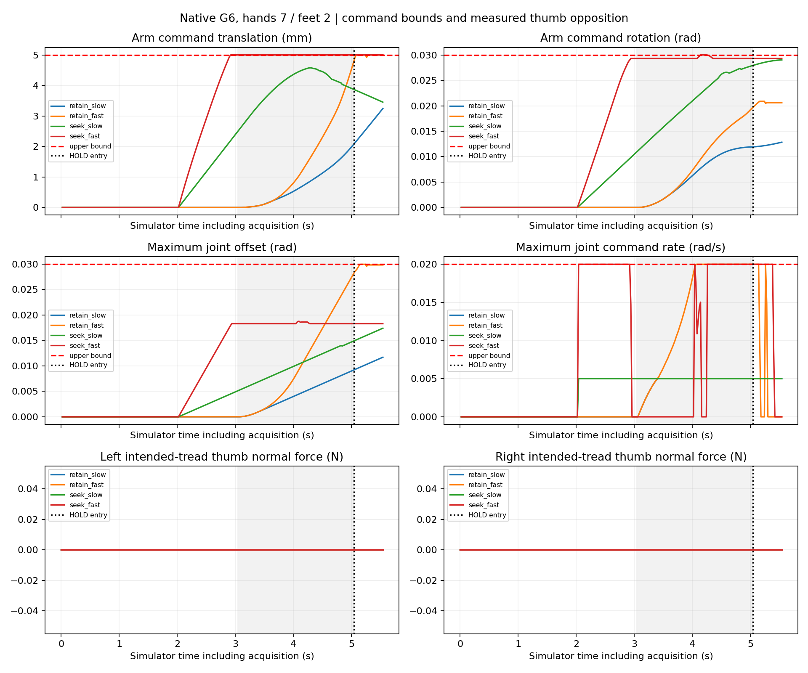

# Lowered G6 bounded arm-feedback results

**No stable pose qualified.** The robot was lowered from hands 8 / feet 3 to
**hands 7 / feet 2**, a 265 mm vertical step. Root X remains −40 mm. The fresh
control and all four predeclared feedback variants failed both hand gates
after 0.50 s of unsupported HOLD. That interval is an early abort, not a
successful hold. No candidate advanced to 30, 60 or 120 s, repeat, or finer-step
qualification; load and transfer milestones remain blocked.

| Candidate | Activation (simulator s) | Rate limit (rad/s) | Maximum command shift (mm) | Final RESET drift (mm) | Strict / contact |
|---|---:|---:|---:|---:|---|
| Original lowered control | — | — | — | 2.651 | FAIL / FAIL |
| retain_slow | 3.04 | 0.005 | 3.244 | 4.838 | FAIL / FAIL |
| retain_fast | 3.04 | 0.020 | 5.000 | 8.451 | FAIL / FAIL |
| seek_slow | 2.02 | 0.005 | 4.578 | 7.020 | FAIL / FAIL |
| seek_fast | 2.02 | 0.020 | 5.000 | 6.274 | FAIL / FAIL |

The source was frozen clean at
`5a9a6ee24f5db84a05af91b5306f6248f2f0cbd8` for all feedback trials.
The lowered control uses the unchanged starting source `7529378`; its complete
trace is byte-identical to the earlier `e_00_probe` evidence. Prior experiments
and project defaults are preserved.

## What failed

Both retained-reference trials started from an invalid acquired grasp: eight
fingers were loaded, while both thumb normal forces were zero. Retaining that
wrist reference preserved the missing opposition. The first premise audit
records these actors and removes the assignment of grasp repair to reference
retention before permitting the second pair.

The seeking trials measured native thumb-to-tread gaps of **18.572 mm left and
18.749 mm right** at activation. Their fixed target shifts were capped at
5 mm. The faster trial reached both its 5 mm translation and 0.03 rad rotation
bounds; both thumb normal forces remained zero in every logged phase. All
eight fingers were still loaded at the final sample. The second premise audit
records the same failure and closes the four-variant budget.

Minimum knee/shin clearance remained at least **38.06 mm** throughout the
recorded trajectories. Peak actuator effort was **58.14%** of the physical
limit in every trial. Neither clearance nor spare actuator margin establishes
an anatomical grasp. The evidence points to acquisition geometry as the next
problem to solve; it does not demonstrate that G6 is impossible. A further
campaign should establish actual thumb opposition under the existing joint
and contact limits before assigning stabilization to this bounded wrapper.

## Verification

- Original G6 geometry, masses, inertias, actuator limits, contact masks and
  solver settings were preserved. Native actual hand-contact vectors were
  `[1.8, 1.8, 0.02, 0.002, 0.002]`; no material override was used.
- All **2,500 scored 1 ms physics steps** have zero `qfrc_applied` and
  `xfrc_applied`. Full contact streams contain 27,700 physics samples across
  acquisition, removal and HOLD. Control remained 20 ms.
- Independent reconstruction from logged applied actuator targets and saved
  MJB models verified all **1,108 feedback command samples**: translation
  ≤5 mm, rotation ≤0.03 rad, joint offset ≤0.03 rad, and each declared rate.
  These checks do not trust the controller's self-reported bounds.
- All five owned XML/MJB pairs match in **584 public numeric fields/options**.
  The default model/reset matches **471 reviewed entries**. Source snapshots
  contain 106 exact feedback-runtime files and 104 exact control-runtime files.
- The broad suite passed **278 tests**. Focused controller/legacy checks,
  evidence reconstruction, real short-trial integration and six additional
  input-boundary cases passed separately. All **eight behavioral mutations**
  were killed. Counts from overlapping runs are not added together.
- Named crapper/dryer/mutator tools were unavailable. Radon plus measured
  coverage found no changed production function with CRAP ≥10; the AST
  comparison found no similarity ≥0.8 for bodies of at least 50 nodes.

The archive includes all five raw trials, immutable ledger and premise audits,
plots, labelled control/seek state replays, physical assets, exact source
snapshots, Git history and validation logs. Replays reconstruct recorded state
without physics stepping and remain labelled FAIL. See [README.md](README.md),
[WORK_LOG.md](WORK_LOG.md) and [artifact.json](artifact.json).
