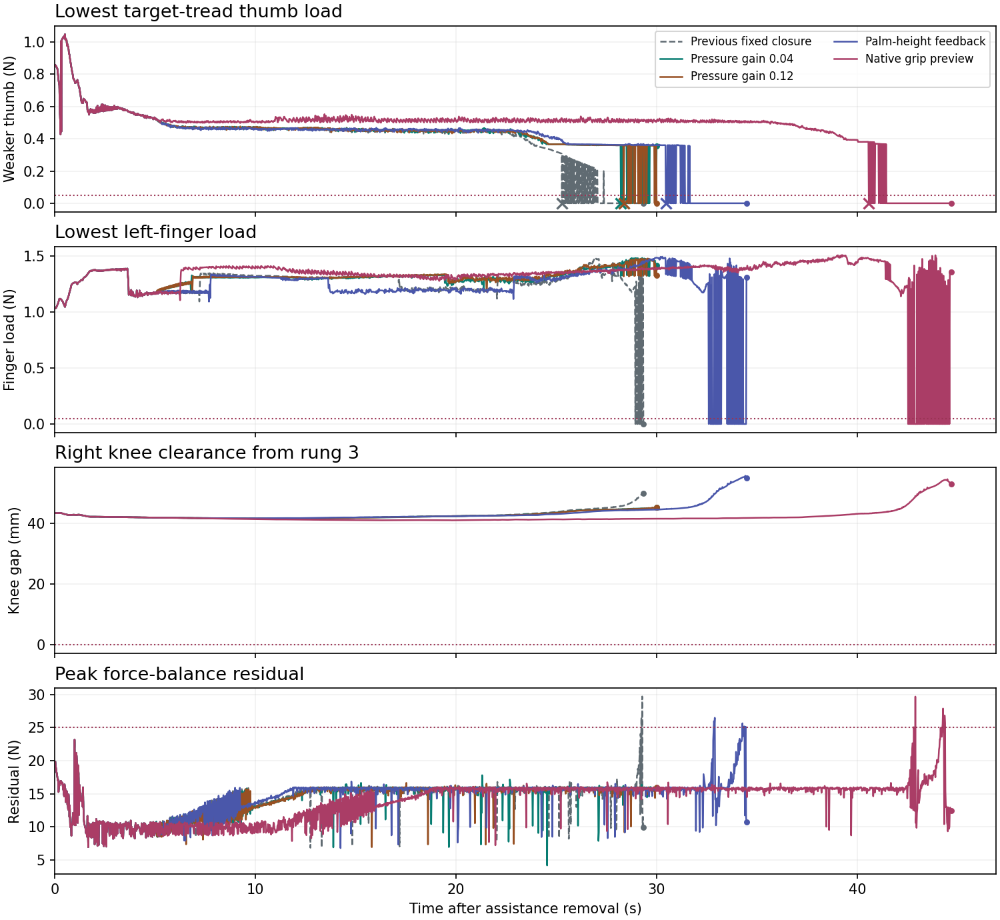

# Bounded grip feedback on G6

**The native-interval grip controller met all four requested contact, clearance and force conditions through 40.562 s of unsupported hold. Its right thumb first lost opposition at 40.563 s. None of the four refinements qualified a stable G1 pose.** Both palm-height configurations passed their fresh 30 s physical screens and failed the 60 s retry. The 120 s nominal, repeat and half-timestep confirmations were therefore ineligible.

| Grip feedback | Longest stage attempted | Actual hold | First native opposition loss | Minimum right-knee gap | Peak native residual |
| --- | ---: | ---: | --- | ---: | ---: |
| Low pressure gain | 30 s | 30.00 s | Left at 28.218 s | 41.578 mm | 23.183 N |
| High pressure gain | 30 s | 30.00 s | Left at 28.351 s | 41.578 mm | 23.183 N |
| Palm height | 60 s | 34.48 s | Left at 30.445 s | 41.629 mm | 26.483 N |
| Palm height with native grip preview | 60 s | 44.68 s | Right at 40.563 s | 40.978 mm | 29.688 N |

Each point represents a 20 ms interval. The load curves include the weakest native or endpoint observation, the residual shows the largest value, and the gap shows the minimum integrated native distance. Crosses mark the first interval with lost opposition. Dotted lines show the physical limits.

## Pressure feedback and palm height

The previous fixed-closure controller first lost right-thumb opposition at 25.272 s. Two pressure controllers adjusted individual closure limits from fingertip loads while retaining the same native preload. Each finished its 30 s screen with zero knee contacts, at least 41.57 mm of knee clearance, a weakest left finger of 1.035 N and a peak residual of 23.183 N. Each lost opposition on 17 left-thumb solver steps. The higher gain also lost opposition on two right-thumb steps. All 1,500 controller endpoints showed both thumbs opposed in each run. [Previous fixed-closure trial](../g6_knee_clearance/OUTCOMES.md)

Coordinating the four fingers of each hand from palm height passed the full 30 s physical screen. The minimum native loads were 0.427 N on the left thumb and 0.360 N on the right. The left index, middle, ring and pinky minima were 1.262, 1.194, 1.035 and 1.047 N. Minimum knee clearance was 41.629 mm. Force residual peaks were 23.183 N at the 1 ms physics steps and 18.579 N at the 20 ms control endpoints. During those 30 s the base, center of mass and palms had translation excursions of 7.34, 6.07, 5.67 and 7.72 mm, respectively. The 120 s stationarity test allows at most 2 mm over its final 30 s.

| Palm-height 60 s retry | Time after assistance removal |
| --- | ---: |
| First left-thumb opposition loss | 30.445 s |
| First right-thumb opposition loss | 31.438 s |
| Left index first fell below 0.05 N | 32.596 s |
| First endpoint and native residuals at or above 25 N | 32.860 and 32.861 s |
| Peak native residual of 26.483 N | 32.886 s |
| Drift and both hand-support gates stopped the hold | 34.480 s |

The left index unloaded on 51 native steps. The other three left fingers stayed above 1 N. The minimum knee gap in this retry was 41.629 mm, and the gap at the stop was 55.432 mm. Both palms then sat more than 17 mm below their hold-entry heights. Six native samples and one controller endpoint exceeded the force limit.

## Native-interval grip preview

The fourth configuration kept both thumbs opposed and all left fingers loaded throughout its 30 s screen. Minimum left and right thumb loads were 0.500 and 0.427 N. Minimum knee clearance was 40.978 mm, and the peak native residual was 23.183 N. The controller evaluated 371 alternative hand commands across 180 of the 1,500 control intervals. In 176 intervals it selected the alternative that increases the closure limits for the four fingers of each hand. Every nominal forecast in this screen already met the hard contact and force limits. The selected alternatives increased the forecast load reserve. The largest closure-limit change from capture was 0.0274 rad.

On the 60 s retry, the first 40,562 native steps and all 2,028 intervening controller endpoints met the four requested conditions. Minimum opposed loads on the left and right thumbs were 0.418 and 0.381 N. The weakest left finger carried 1.035 N. The right knee stayed at least 40.978 mm clear, and the residual peaked at 23.183 N. The first failing interval ended at 40.580 s. The nominal grip and all three alternative commands predicted a zero opposed load on the right thumb within that interval. Their left-finger minima exceeded 1.46 N, and their residual peaks were below 15.52 N. The right-thumb loss appeared in the raw contacts 1.077 s before the first right-thumb loss at a controller endpoint.

The left thumb first lost opposition at 41.409 s. The left index first unloaded at 42.524 s and unloaded on 57 native steps in total. The left middle, ring and pinky stayed above 1 N throughout. The residual crossed 25 N at 42.803 s and peaked at 29.688 N at 42.896 s. Eight native steps exceeded the limit. The largest control-endpoint residual was 24.633 N. Drift and both hand-support gates stopped the hold at 44.680 s. At that point the left and right palms were 17.42 and 16.01 mm below their hold-entry heights and the right-knee gap was 53.464 mm.

Over the 2,234 intervals of that retry the adviser evaluated 1,766 extra commands, selected an alternative 409 times and encountered 181 intervals in which every evaluated command failed at least one hard thumb, finger or force condition. The one-interval preview delayed the first opposition loss by 10.118 s relative to the palm-height controller.

## Verification and reproduction

The four refinements and two matched controls produced 12 fresh MuJoCo trials with hands on rung 7 and feet on rung 2. The independent checks covered 289,760 physics records, including 229,280 unsupported steps. All unsupported external force and torque arrays were zero. The native hand–tread friction vector was `[1.8, 1.8, 0.02, 0.002, 0.002]`. All 471 reviewed model and reset fields matched. Every trial recorded zero unintended-support steps, zero housing-contact steps and zero right-knee contacts with rung 3.

The verifier reconstructed opposition and per-digit load from raw target-tread contacts, the force residual from signed contact forces and weight, and knee clearance from the saved joint positions and the seven knee meshes. For every 20 ms interval in the native-preview runs, each selected thumb forecast exactly matched the minimum opposed load measured across its solver steps and endpoint. Reopening both ledgers preserved all 12 run identities and 240 evidence-file hashes.

Both simulator checkouts ran on `dex-hand-exp`. The first three refinements used `91eeb57` and the native-preview refinement used `8e55670`. The raw records, source archives and per-trial verification reports are under `outputs/g1_o6/g6_grip_feedback` and `outputs/g1_o6/g6_grip_preview`. [Measured results and hashes](results.json) · [Protocol and commands](README.md) · [Work log](WORK_LOG.md)
