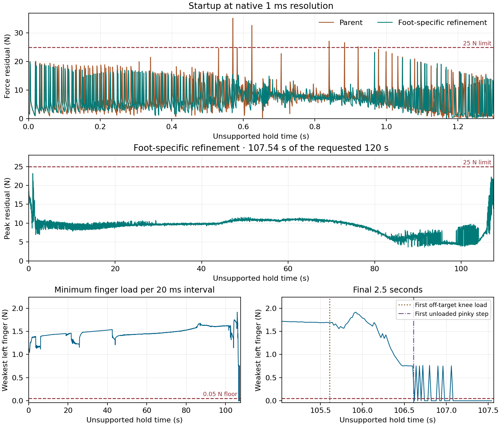

# G6 ground-reaction refinement

**One controller kept the force-balance residual below 25 N for the entire 107.54 s hold. No stable G1 pose qualified.** The foot-specific controller with a 16 N preview target passed fresh 5, 30 and 60 s stages. In the requested 120 s hold, the right knee first loaded rung 3 at 105.610 s, the left pinky first unloaded at 106.611 s, and the original unintended-support gate aborted the trial at 107.540 s. Both hands targeted rung 7 and both feet targeted rung 2 throughout.

## Force and finger loading

Each row starts from a fresh model reset. The residual is the magnitude of gravity plus the signed world-frame forces at all robot–environment contacts. The two peaks use native 1 ms solver samples and 20 ms control endpoints, respectively. The finger minimum covers every native step and each of the four left non-thumb fingers on the target tread. Both thumbs are assessed separately by the original grasp gates.

| Controller | Requested (s) | Recorded hold (s) | Native peak (N) | Control peak (N) | Native steps ≥25 N | Weakest left finger (N) | Stage result |
| --- | ---: | ---: | ---: | ---: | ---: | ---: | --- |
| Ground-reaction parent | 5 | 5.02 | 35.150 | 25.674 | 5 | 1.026 | Force limit |
| Common trim, 16 N | 5 | 5.02 | 31.093 | 18.867 | 2 | 1.026 | Force limit |
| Common trim, 21 N | 5 | 5.02 | 31.037 | 18.901 | 3 | 1.026 | Force limit |
| Foot-specific trim, 16 N | 5 | 5.02 | 23.183 | 18.579 | 0 | 1.035 | Passed |
| Foot-specific trim, 21 N | 5 | 5.02 | 31.028 | 18.901 | 3 | 1.026 | Force limit |
| Foot-specific trim, 16 N | 30 | 30.00 | 23.183 | 18.579 | 0 | 1.035 | Passed |
| Foot-specific trim, 16 N | 60 | 60.02 | 23.183 | 18.579 | 0 | 1.035 | Passed |
| Foot-specific trim, 16 N | 120 | 107.54 | 23.183 | 21.251 | 0 | 0.000 | Unintended support and finger unloading |

The parent also crossed 25 N at one control endpoint. All four refinements stayed below 25 N at the control endpoints. The native-step records exposed impulses that disqualified three of the four configurations. The surviving configuration made 42 adjustments to the parent's command during its five-second probe.

## Why the long hold ended

At 79.260 s, when the earlier arm-only hold began sustained pinky unloading, the refined G1 carried 1.522 N on the left index, 1.749 N on the middle, 1.806 N on the ring and 1.799 N on the pinky. All four fingers stayed loaded past that point. [Earlier grasp-acquisition results](../g6_grasp_acquisition/OUTCOMES.md)

The first off-target support was the right knee against rung 3 at 105.610 s, with 2.281 N of normal force. That same pair accounted for all 1,566 native steps with unintended support and peaked at 11.491 N. The force-balance residual includes this knee contact. The original support gate evaluated it independently.

| Left finger | Minimum load in the 60 s trial (N) | First native step below 0.05 N in the long trial (s) | Unloaded native steps |
| --- | ---: | ---: | ---: |
| Index | 1.210 | Stayed loaded | 0 |
| Middle | 1.194 | 107.265 | 4 |
| Ring | 1.035 | 106.616 | 30 |
| Pinky | 1.047 | 106.611 | 44 |

In the complete 60–90 s window, the base, COM, left palm and right palm moved 2.54, 2.97, 5.30 and 5.56 mm, respectively, against a 2 mm excursion limit. Both wrist commands had already reached their 5 mm displacement bound at the 5 s checkpoint. By 105 s the left palm was 15.64 mm higher than at hold entry. The abort left the required 90–120 s convergence window incomplete. The nominal repeat and half-timestep confirmation require a qualified 120 s hold.

## Verification

The matched parent reproduced its previous control trace byte for byte. The independent verifier checked 262,980 physics contact records across eight trials, including 222,660 steps after assistance removal. All scored external-force arrays were zero. No housing contact occurred. Hand–tread friction was native throughout at `[1.8, 1.8, 0.02, 0.002, 0.002]`. All 471 reviewed model and reset fields matched. Every selected preview reproduced its executed interval's peak residual and weakest finger load with zero measured difference.

The simulator ran at `fd2b33224fbb7cc22312e5b3b6b2f893ff77ac56` on `dex-hand-exp`. The raw evidence and archived source are in `outputs/g1_o6/g6_ground_reaction`. The machine-readable record includes per-trial checksums, force crossings, per-finger loss times and the original motion assessments. [Results](results.json) · [Protocol and commands](README.md) · [Work log](WORK_LOG.md)
