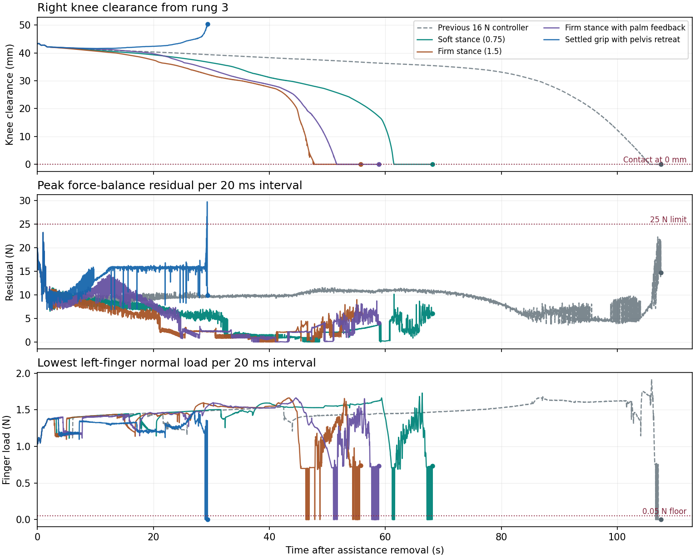

# G1 knee clearance and stable holds on G6

**The soft stance controller met all three requested conditions for 60.02 s. None of the four refinements qualified a stable 120 s pose.** The successful hold maintained 13.266 mm of right-knee clearance, with a 23.183 N native peak residual and an 18.579 N control-endpoint peak. The minimum loads on the left index, middle, ring and pinky were 1.255, 1.194, 1.035 and 1.047 N. The left and right thumb minima were 0.549 and 0.427 N.

The posture continued to move. During 30–60 s the floating base, center of mass and left and right palms had translation excursions of 7.24, 9.03, 6.99 and 7.25 mm, respectively. The convergence limit is 2 mm. The fresh 120 s retry stopped at 68.14 s, before the required 90–120 s assessment. No configuration reached the nominal repeat or the 0.5 ms confirmation.

## What moved in the stance trials

The preceding foot-specific 16 N controller passed a 60 s hold. On its 120 s attempt the right ankle advanced 47.19 mm and pitched 11.18° by 105 s. The pelvis advanced 6.03 mm over the same interval. The right knee loaded rung 3 at 105.610 s, and the hold ended at 107.54 s. The new trials retained the acquired posture with both hands on rung 7 and both feet on rung 2. [Previous ground-reaction experiment](../g6_ground_reaction/OUTCOMES.md)

At 30 s, the previous controller had 39.34 mm of knee clearance. Adding foot feedback left 36.51 mm at gain 0.75 and 31.96 mm at gain 1.5. The right ankle advanced 4.12, 4.79 and 7.26 mm respectively. Adding palm feedback to the firmer controller recovered 2.02 mm of clearance at the 30 s endpoint. Both its palm translation and rotation corrections reached their 12 mm and 0.020 rad bounds.

| Configuration | Last stage requested | Unsupported hold | First left finger below 0.05 N | First nonpositive knee gap | First native knee contact | Peak knee load |
| --- | ---: | ---: | --- | ---: | ---: | ---: |
| Soft stance | 120 s | 68.14 s | Ring at 61.208 s | 61.484 s | 61.485 s | 12.09 N |
| Firm stance | 60 s | 55.72 s | Pinky at 46.285 s | 47.502 s | 47.789 s | 8.93 N |
| Firm stance with palm feedback | 60 s | 58.86 s | Pinky at 51.052 s | 51.613 s | 51.622 s | 9.06 N |

In all three cases, left-finger unloading came before the first knee contact. The right knee against rung 3 accounted for every native step with unintended support in these holds. The ankles had advanced 45.75–46.39 mm and the left palms had risen 16.63–16.85 mm by the stops. The peak force-balance residual in each trial was 23.183 N at the native rate and 18.579 N at the control endpoints.

The 30 s stance screens also showed continuing hand closure after thumb opposition. The firm controller advanced the four left-finger targets by 0.145–0.175 rad. The final configuration captured the applied targets of both settled grasps and capped further closure. It returned to the foot-specific 16 N parent and requested up to 8 mm of pelvis retreat when the measured knee gap fell below 35 mm.

## What ended the settled-grip trial

Both hands met the capture conditions at 5.000 s. The ceiling limited closure in all 1,217 subsequent commanded intervals, by up to 0.0320 rad. The knee gap stayed above 41.592 mm throughout and was 50.360 mm at the stop. It never crossed the 35 mm trigger, so the requested pelvis retreat stayed at zero.

| Native observation | First time in HOLD |
| --- | ---: |
| Right thumb lost its qualifying tread load | 25.272 s |
| Left thumb lost its qualifying tread load | 27.667 s |
| Left index load fell below 0.05 N | 28.926 s |
| Residual reached 26.55 N | 29.228 s |
| Residual peaked at 29.70 N | 29.274 s |
| Both hand-support gates stopped the hold | 29.340 s |

The left index unloaded on 12 native steps. The other three left fingers stayed above 0.94 N. The two force excursions occurred between control endpoints. The 20 ms peak was 18.579 N. At the stop, both hands still carried contact force and both had lost opposition. No unintended support or knee contact occurred in this trial.

## Evidence and reproduction

Four refinements and two matched control probes produced 14 fresh trials. Both controls exactly reproduced the archived five-second command trace. The verifier reconstructed the seven right-knee mesh distances from the recorded joint positions, per-finger loads from native contacts, and the residual from signed environment forces and gravity. It checked 462,760 native physics records, including 392,200 unsupported steps. All unsupported external-force arrays were zero. Hand–tread friction was native throughout at `[1.8, 1.8, 0.02, 0.002, 0.002]`. The 471 reviewed model and reset fields matched, and every chosen force preview reproduced the executed peak residual and minimum finger load.

The raw traces and source archives are in `outputs/g1_o6/g6_knee_clearance` and `outputs/g1_o6/g6_knee_retention`. The simulations ran on `dex-hand-exp` at `a71e67a` and `cfe543f`, respectively. Resuming from those revisions reproduced both decisions and retained all 14 run identities and 280 file hashes. The machine-readable results include the raw evidence hashes, clearance at both sampling rates, force crossings, finger-load loss times and convergence windows. [Results](results.json) · [Protocol and commands](README.md) · [Work log](WORK_LOG.md)
