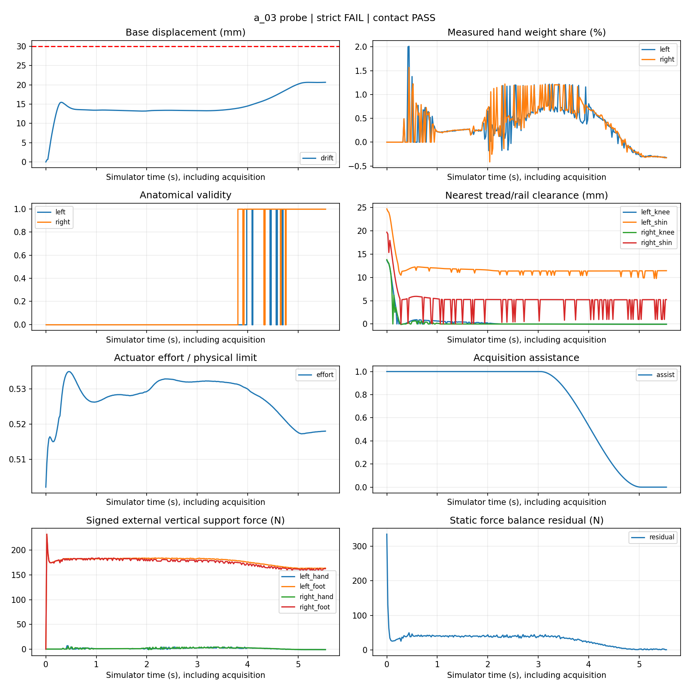
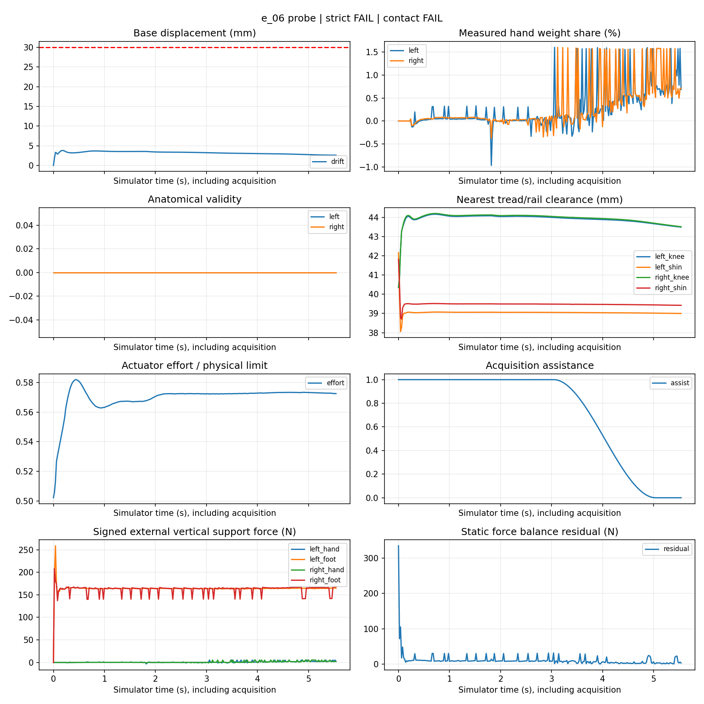

# G6 stable-pose search outcome

**No stable G6 pose qualified.** The implementation and bounded search are
complete, but the physical task is unsuccessful. Across 48 configurations,
46 dynamic trials failed and two resets were rejected for interpenetration.
No candidate passed the 5 s probe. The project default remains unchanged.

| Milestone | Status | Evidence |
|---|---|---|
| Stable initial G6 pose | FAIL | No strict/contact probe pass; no qualified 30/60/120 s sequence |
| Load-bearing grasp | BLOCKED | Initial pose unqualified; no new free-wrist capacity or 30% loading trials |
| Controlled release | BLOCKED | Initial pose and loaded hold unqualified |
| Same-tread reacquisition | BLOCKED | Release prerequisites unqualified |
| Adjacent-tread hand transfer | BLOCKED | Same-tread and mixed-height prerequisites unqualified |

The 60/120 s promotions, nominal/fine confirmations, capacity matrix, 5/10/20/30%
loading, release and transfer trials are **NOT RUN**. Their milestone status is
BLOCKED by missing prerequisites. Software tests and recorded-state videos do
not establish those physical outcomes. The highest qualified physical stage is
none.

## Reproduction and search

The native 8/3 control reproduces the reviewed failure exactly: all 278 trace
rows and the complete trace SHA-256 match
`20fd41d5d87e801ae1ba41a3c0423600d542448734c0e85ba4aee293f6de9441`.
It aborts after 0.50 s of HOLD with right-knee contact on front tread 4 and a
failed anatomical contact gate. This interval is an abort guard, not a hold pass.

| Batch | Configurations | Dynamic / reset rejected | Anatomical passes | Selected diagnostic parent |
|---|---:|---:|---:|---|
| Reproduction control | 1 | 1 / 0 | 0 | control, hands 8 / feet 3 |
| A: root, pelvis, waist | 12 | 10 / 2 | 3 | a_03, root X +40 mm |
| B: lower supports, foot placement | 8 | 8 / 0 | 2 | b_00, hands 7 / feet 2 |
| C: grip geometry | 12 | 12 / 0 | 10 | c_05, grip X −18 mm |
| D: closure and preload | 7 | 7 / 0 | 7 | d_04, thumb target +0.1 rad |
| E: separate clearance-safe follow-up | 8 | 8 / 0 | 0 | No qualifying candidate |

The first campaign contains exactly 40 declared configurations, including its
control. Batch E is a separate, predeclared eight-case ledger. All 48 records
completed without a technical trial error. The [candidate table](CANDIDATES.csv)
retains every resolved pose, reset offset, duration, terminal cause, contact
status, drift, body clearance and peak actuator effort. All individual traces,
first-crossing/persistence timelines and acquisition plots are in the archive.

The longest early-abort interval is 3.18 s (`a_08`, waist −0.10 rad); it fails
drift and unintended support and also fails anatomical quality. Ranking by this
duration would not identify a valid pose.

## Measured limiting mechanisms

The contact-valid branch retains prohibited knee support. For `a_03`, the right
and left knees first touch front tread 4 at 0.266 and 0.269 s, already during
acquisition. Both remain implicated in the later physical failure. At the final
sample, the hands exert **−1.08 and −1.09 N** vertical force while the feet
provide **163.76 and 162.62 N**. Valid squeeze/opposition therefore does not
establish useful upward hand loading. Moving the same support separation down
to 7/2 or 6/1 does not remove this mechanism. Shortening that separation to 7/3
or 6/2 loses overall support during removal.

The alternative `a_00` (root X −40 mm) keeps the knee regions approximately
40 mm clear and shin regions approximately 38 mm clear throughout the recorded
trajectory. However, both thumbs become unloaded. Final wrist displacement
relative to RESET is roughly +10 mm X and −6/−7 mm Z in the tread frame.
The second batch drops the assumption that the greedy contact-valid parent
must remain the search reference. It tests lower supports, grip Z +5/+10 mm,
one −5 mm grip X combination and thumb closure +0.1/+0.2 rad, retaining the
clearance-safe root offset and original controller. All eight fail both hand
gates after 0.50 s HOLD despite 38–40 mm minimum knee/shin clearance.

In `e_06`, both final thumb normal forces are zero; hand vertical reactions are
only 2.30 and 2.38 N. RESET drift is 2.60 mm and peak actuator effort is 58.2%
of the physical limit. Small drift and unused actuator margin do not repair
the missing thumb opposition.

No current result demonstrates a free-wrist load-bearing grasp or a transferable
pose. The two failure branches identify a coupled acquisition/contact problem;
they do not prove that G6 is impossible.

## Verification and artifacts

- Physics used the unchanged native G6 scene, original hold controller,
  1 ms physics and 20 ms control. Effective hand contact vectors were
  `[1.8, 1.8, 0.02, 0.002, 0.002]`; no material override was used.
- All **26,480 scored physics steps** have zero `qfrc_applied` and
  `xfrc_applied`. Independent verification checks every saved applied-force row,
  actual contact stream, immutable file hash and model/metadata match.
- All 48 owned XML/MJB pairs agree in 584 public numeric fields/options,
  excluding filename bookkeeping and MuJoCo's binary-load compiler signature.
  The default model/reset still matches all 471 reviewed snapshot entries.
- Runtime source was frozen clean at
  `180b0daa3bb5a67169db2a0d39f4f6ea8c585780` for both search batches.
  The exact 104 source-file bytes and hashes are included. The baseline uses
  reviewed `298cd2f555dcf48637384987ef0668e85f219392` with a separate 91-file
  snapshot. Later commits contain reporting and delivery changes.
- The broad regression suite passed **293 tests**. The later boundary suite
  passed **17 tests**, including five new tests and twelve reruns. The final
  evidence/archive suite passed **7 tests**. These counts are separate runs,
  not a claim of 317 unique tests.
- All **10 targeted behavioral mutations** were killed by assertions. One
  initial selector collected no test; the corrected selector killed that
  mutation. Both logs and the consolidated result are retained.
- Named crapper/dryer/mutator tools were unavailable. Radon with measured
  coverage, AST similarity checks and exact-byte-restored mutations supplied
  the recorded substitutes. Changed production functions have CRAP below 10
  and no measured duplication at or above 0.8 under the documented scope.

The portable archive includes raw failed trials, both ledgers, all plots,
baseline and diagnostic state-replay videos, physical assets, source snapshots,
Git history, validation logs and an entry-by-entry checksum manifest. Portable
XML files are additional exports; original evidence bytes remain intact.
See [artifact.json](artifact.json), [README.md](README.md) and
[WORK_LOG.md](WORK_LOG.md). There is no best-qualified-hold, loaded-hold or
completed-transfer video because none of those stages was achieved.

## Next bounded experiment

Further closure/preload tuning under a fixed arm reference has exhausted this
declared search. A useful next experiment is a separately identified,
contact-aware arm-reference correction around root X −40 mm, hands 7 / feet 2:
hold the measured wrist pose during assistance removal, with at most 5 mm
Cartesian correction and small bounded joint-target increments, while retaining
all existing physical limits and zero scored external force. Predeclare at
most four feedback variants and stop after two repeat failures of the same
mechanism for a new premise audit. This controller experiment has **not** been
run or qualified here; it must restart the complete 30→60→120 s qualification
and subsequent capacity/loading sequence.
