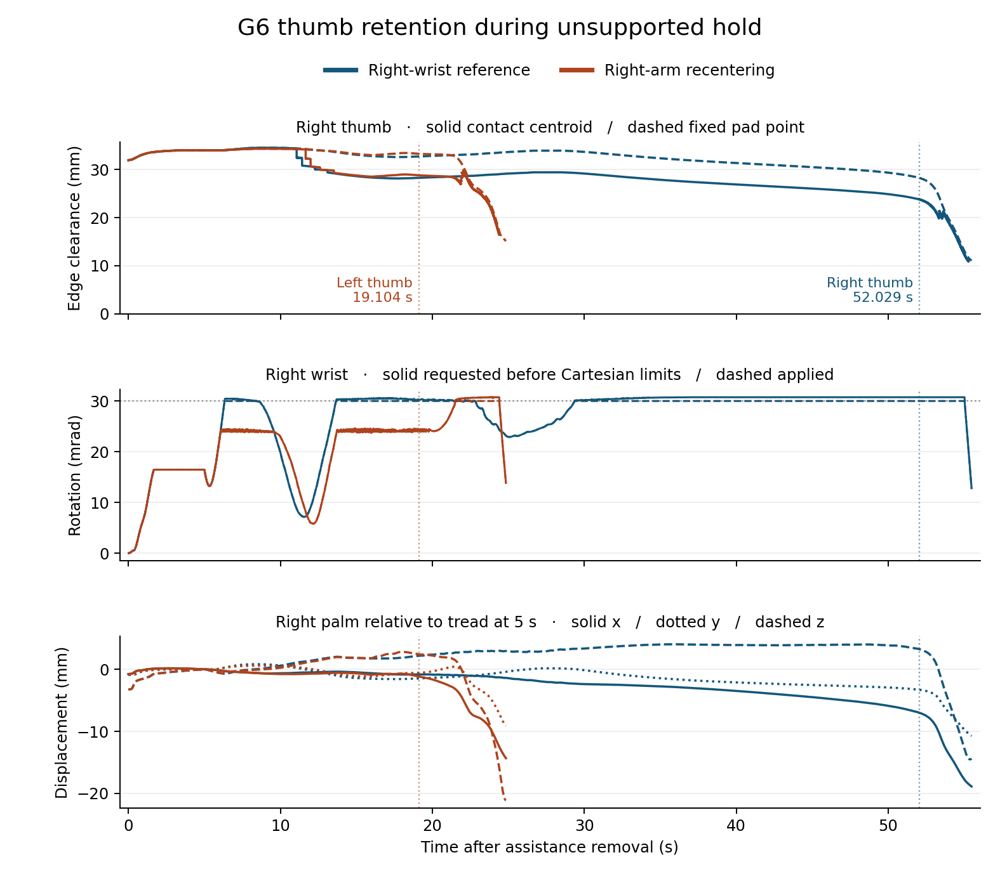

# G6 right-thumb retention

**All three bounded corrections failed the stable-pose gates.** Right-arm recentering delayed the first wrist saturation from 6.340 to 21.520 s, but the left thumb lost opposition at 19.104 s and the right at 21.380 s. Both losses preceded saturation in that trial. Increasing wrist travel alone would leave that failure unexplained.

The independent reference repeat passed 30 s and reproduced the original right-thumb loss at **52.029 s** in its fresh 60 s attempt. The specific cause of that loss remains unresolved.

### What moved before the reference lost opposition

From the 5.000 s capture to 52.028 s, the force-weighted contact centroid traveled 10.88 mm along the tread plane. The fixed material point on the distal thumb traveled 5.96 mm. At the final intact sample the two were 4.95 mm apart in the plane, the centroid still had **23.81 mm of edge clearance**, and its force-weighted slip speed was 1.03 mm/s. The measurements show both contact-patch migration and material motion. The thumb lost loaded contact on the next millisecond while its fixed point was still 28.29 mm inside the edge.

The first applied rotation of 30 mrad, within 0.001 mrad numerical tolerance, occurred at 6.340 s. During all 600 control decisions in the last intact 12 s, the wrist requested more than the Cartesian limit. It requested about 30.75 mrad and applied 30.00 mrad near the loss. The shoulder and elbow retained travel, with less than 20% peak effort in those four joints during that window.

Using a common 2 mm retreat along tread x from the 5 s position, the contact centroid crossed at 11.425 s, the left palm at 18.193 s, the pelvis at 22.815 s and the right palm at 27.371 s. That ordering motivated the right shoulder/elbow experiment. The left arm kept its baseline controller.

### Fresh correction trials

Times are seconds after assistance removal. Every trial used G6, hands on tread 7, feet on tread 2, native friction and a 1 ms physics step. Every physics step and control endpoint had to preserve bilateral thumb opposition, at least 0.05 N on each of the four left fingers, positive right-knee clearance from rung 3, and a force-balance residual strictly below 25 N. The original unassisted support and contact gates also applied.

| Configuration | Requested hold | First failed gate | Hold recorded | Peak residual |
| --- | ---: | --- | ---: | ---: |
| Matched right-wrist control | 5 s | Passed | 5.020 s | 23.18 N |
| Right target 2 mm inward | 5 s | Force balance at 0.847 s | 5.020 s | 29.89 N |
| Right wrist pre-oriented 0.010 rad | 5 s | Force balance at 0.603 s | 5.020 s | 33.30 N |
| Right shoulder/elbow recentering | 5 s | Passed | 5.020 s | 23.18 N |
| Right shoulder/elbow recentering | 30 s | Left-thumb opposition at 19.104 s | 24.840 s | 25.35 N |

The independent reference sequence used three additional fresh resets. All three command and state traces matched their archived SHA-256 hashes byte for byte.

| Reference repeat | First failed gate | Hold recorded | Peak residual |
| --- | --- | ---: | ---: |
| 5 s | Passed | 5.020 s | 23.18 N |
| 30 s | Passed | 30.000 s | 23.18 N |
| 60 s | Right-thumb opposition at 52.029 s | 55.480 s | 27.05 N |

The two acquisition changes preserved both opposed thumbs and all four loaded left fingers throughout their probes. At their first force failures the feet together supplied 296.08 N and 293.15 N vertically, respectively. The hands supplied 8.41 N and 7.99 N against a robot weight of 334.34 N. Compared with the reference at those same milliseconds, the largest change was under the left foot, which supplied 22.20 N and 24.89 N less. The 2 mm target shift reduced the actual centroid margin at capture from 33.98 to 31.21 mm, so the conditional 4 mm shift was ineligible.

Pre-orientation followed the measured unserved rotation in tread coordinates. Recentering activated near 24 mrad and limited the right shoulder and elbow to 0.005 rad/s. All original actuator, wrist and force gates remained active. In the recentering screen, the left fingers first unloaded at 21.925 s and the force residual crossed 25 N at 22.124 s. The closest right-knee gap was 41.58 mm.

### Milestones

| Milestone | Outcome |
| --- | --- |
| Stable initial pose | Failed. Each correction failed before a 60 s promotion. The 120 s convergence trial, nominal repeat and 0.5 ms confirmation were ineligible. |
| Load-bearing grasp | Blocked at pose qualification. Isolated 1.2× wrist-wrench reserve and coupled 5–30% weight plateaus remain unmeasured. |
| Controlled hand transfer | Blocked. Neither hand qualified for independent unloading, a three-support hold, same-rung regrasp or transfer to rung 8. |

The coupled load and adjacent-transfer wrappers reproduced every source actuator command and joint position through wrist capture. With recentering active, each wrapper matched 558 control ticks through 6.120 s of unsupported hold, including two proximal corrections. These were controller-compatibility checks with the transfer commands idle. The isolated free-wrist bench accepts the bounded closing law and rejects this bilateral preview controller. It now records that limitation as a blocked capacity result.

The downloadable plot data contain native timestamps, distances and 3D points in metres, contact slip in m/s, and opposed loads and residuals in newtons. Wrist vectors are in radians at the separate 20 ms control timestamps. The two prefixes identify the fresh reference and the recentering candidate. A missing contact centroid is stored as NaN. [Native comparison traces](comparison.npz)

[Per-trial measurements and raw-file hashes](results.json) · [Controller compatibility measurements](handoff.json) · [Work log and reproduction commands](WORK_LOG.md) · [Prior wrist report and media](../g6_wrist_grip/SHORT_REPORT.md)
