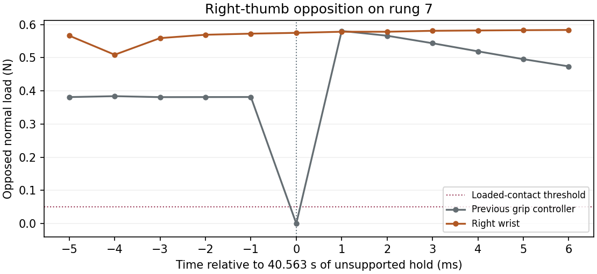
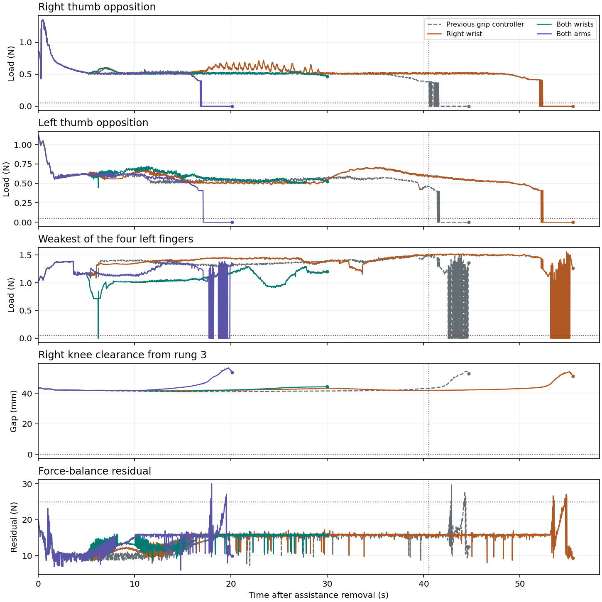

# G6 wrist and grip hold results

Right-wrist feedback kept the right thumb opposed at 40.563 s. At that 1 ms physics step the opposed right and left thumbs carried 0.575 and 0.601 N, the weakest left finger carried 1.518 N, the right knee cleared rung 3 by 41.912 mm and the force-balance residual was 1.583 N. The preceding controller had zero right-thumb contacts on that same step. [Preceding grip experiment](https://github.com/maximbess/Teleopit/blob/f27fa4c/docs/g1_o6/g6_grip_feedback/OUTCOMES.md)

**None of the three bounded configurations qualified a stable G1 pose on G6.** Only the right wrist passed the 30 s screen. Its 60 s failure left the nominal 120 s hold, repeat and half-timestep confirmation ineligible.

| Feedback | Longest stage attempted | Hold completed | First failed physical condition | Minimum knee gap | Peak native residual |
| --- | ---: | ---: | --- | ---: | ---: |
| Right wrist | 60 s | 55.480 s | Right thumb at 52.029 s | 41.518 mm | 27.051 N |
| Both wrists | 30 s | 30.000 s | Left pinky at 6.206 s | 41.302 mm | 23.183 N |
| Both arms, including wrists | 30 s | 20.100 s | Right thumb at 16.819 s | 41.767 mm | 30.040 N |

## Right-wrist retry

The fresh 30 s screen passed. In the fresh 60 s retry, both thumbs remained opposed, all four left fingers stayed loaded, the knee stayed clear and the residual remained below 25 N through 52.028 s. Over those 52,028 native steps, the minimum loads were 0.411 N on the left thumb, 0.412 N on the right thumb and 1.035 N on the weakest left finger. The residual peaked at 23.183 N. The first right-thumb loss came 11.466 s later than with grip feedback alone. The minimum knee gap over the entire retry was 41.518 mm.

From the 5.000 s capture to the 40.560 s endpoint, the right thumb's force-weighted contact centroid moved 7.59 mm along the underside of rung 7. The preceding controller's centroid moved 9.33 mm over the same interval. The new right-arm command displaced the wrist mount by 1.46 mm and reached the 0.030 rad rotation limit at 40.560 s. The preceding command displaced the mount by 5.00 mm.

| Event in the 60 s retry | Time after assistance removal |
| --- | ---: |
| First right-thumb opposition loss at a native step | 52.029 s |
| First left-thumb opposition loss at a native step | 52.184 s |
| First right-thumb loss at a control endpoint | 52.420 s |
| First left-thumb loss at a control endpoint | 52.480 s |
| First unloaded left index finger at a native step | 53.185 s |
| First native residual at or above 25 N | 53.434 s |
| Peak native residual, 27.051 N | 54.791 s |
| Hold stopped on drift and both hand-support gates | 55.480 s |

For the interval ending at 52.040 s, the nominal grip and all three alternative grips predicted zero opposed right-thumb load. Every option kept the weakest left finger above 1.44 N and the residual below 16 N in that interval. Across the retry, the controller evaluated 2,440 alternative commands and selected one in 809 of 2,774 intervals. At the stop, the left and right palms had dropped 12.44 and 11.16 mm from hold entry.

The left index unloaded on 51 native steps. The left middle, ring and pinky stayed loaded throughout. Ten native steps reached or exceeded 25 N. Every control endpoint stayed below the force limit, with a peak of 23.378 N.

## Bilateral wrist retry

Both thumbs remained opposed over the full 30 s screen. The left pinky unloaded on two 1 ms steps, first at 6.206 s, and the left ring finger unloaded once at 6.222 s. All 1,500 control endpoints showed the left fingers loaded. The minimum knee gap was 41.302 mm and the peak native residual was 23.183 N. The native finger gate disqualified this configuration from a 60 s retry.

## Bilateral arm retry

After both wrist configurations failed, the third configuration shared each thumb correction across all seven joints of its arm. It passed the grasp probe. Its fresh 30 s screen lost right-thumb opposition at 16.819 s and left-thumb opposition at the 17.120 s control endpoint. The left index first unloaded at 17.705 s. The residual first crossed 25 N at 17.909 s and peaked at 30.040 N. Drift and loss of both hand supports stopped the hold at 20.100 s. The knee remained clear throughout.

The lines show 20 ms intervals of unsupported hold. Loads are the minimum opposed thumb and left-finger forces across the native steps and endpoint. The clearance is the minimum native distance and the residual is the interval maximum. The vertical line marks 40.563 s. The dotted horizontal lines mark the physical thresholds.

## Verification

The eight fresh trials used MuJoCo 3.8.1, both hands on rung 7, both feet on rung 2 and native friction. The observed hand–tread friction vector was `[1.8, 1.8, 0.02, 0.002, 0.002]`. All 471 reviewed model and reset fields matched. The independent replay checked 195,980 physics records, including 155,660 unsupported steps. Applied external forces and torques were zero throughout unsupported hold. Every trial recorded zero unintended-support steps, zero housing-contact steps and zero right-knee contacts with rung 3.

The replay reconstructed target-tread load and opposition, signed force residuals, distances to all seven right-knee meshes and the executed wrist commands from contacts, joint positions and the saved model. The selected thumb-load and force-residual forecasts matched the executed intervals. Reopening the campaign preserved all eight trial identities and all 160 evidence hashes. Fresh control and right-wrist probes from the working checkout also reproduced their command traces byte for byte. The raw records and the 124-file simulator archive are under `outputs/g1_o6/g6_wrist_grip`. [Trial measurements and hashes](results.json) · [Protocol and reproduction commands](README.md) · [Work log](WORK_LOG.md)
