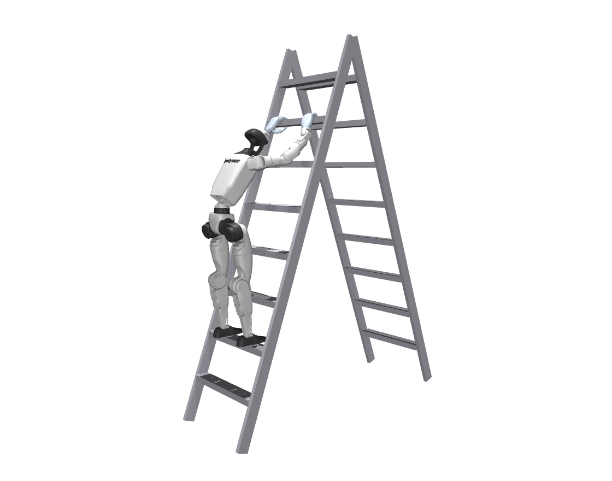
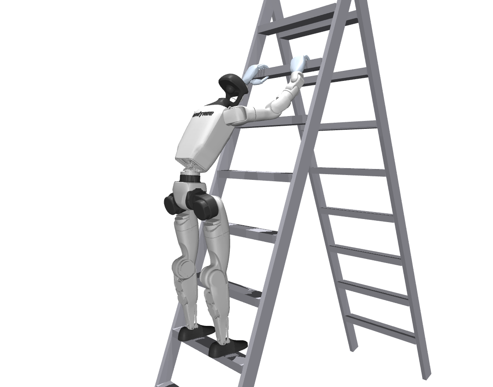
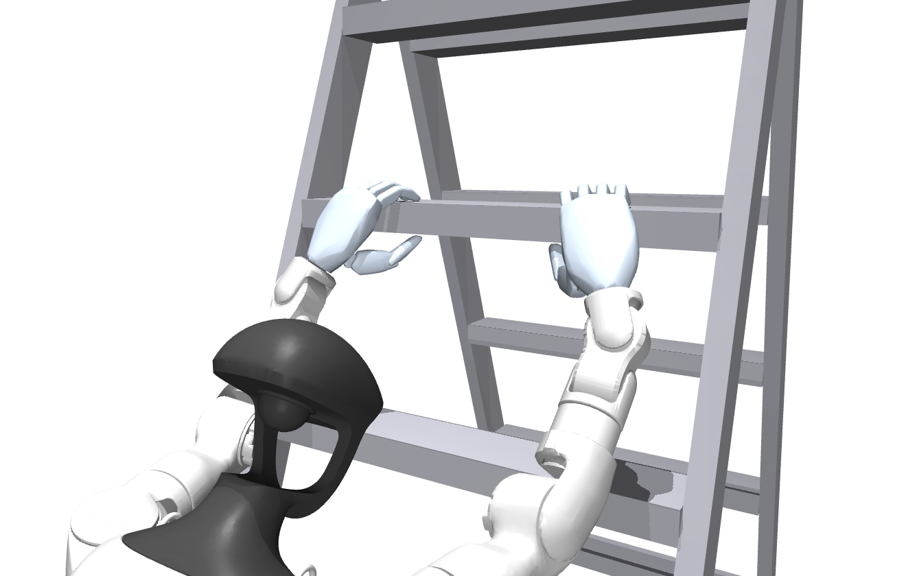
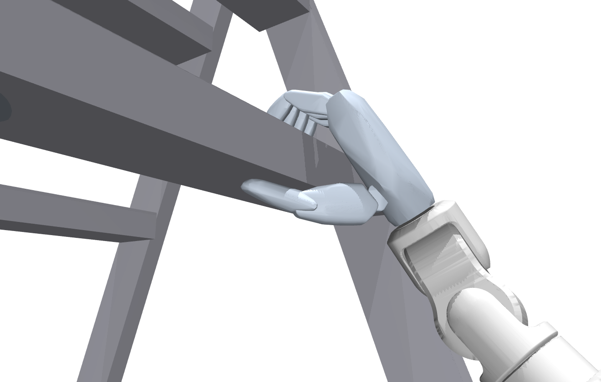

# G1 hold on G6 with wrist and grip feedback

Once the grasp settled, the new controller adjusted the wrist using the thumb’s motion along rung 7 and its normal force against the tread. The grip controller adjusted finger closure within its existing limits. All eight trials used native friction and the existing physical gates, with both feet on rung 2.

**The right wrist kept the right thumb opposed at 40.563 s**, where the previous controller lost contact. The thumb carried 0.575 N at that instant. Both thumbs and all four left fingers stayed loaded through **52.028 s**. Over that interval the force-balance residual peaked at 23.183 N and the minimum right-knee clearance from rung 3 was 41.518 mm.

The first right-thumb loss came at **52.029 s**, 11.466 s later than before. The residual crossed 25 N at 53.434 s, and drift and loss of hand support stopped the hold at 55.480 s. Feedback at both wrists unloaded the left pinky at 6.206 s. Sharing the correction across both arms lost right-thumb opposition at 16.819 s. None of the three configurations qualified for a 120 s hold. [Full measurements](OUTCOMES.md)

**[Watch the complete right-wrist hold (MP4)](media/right-wrist-hold.mp4)**. The real-time replay shows the saved MuJoCo poses from two angles. The readouts show the lowest opposed right-thumb load and highest residual in each 40 ms window. All times start at assistance removal.

| Final trial in the campaign · both arms | Longest trial · right wrist |
| --- | --- |
|  Full pose at the 20.100 s stop. |  Full pose at the 55.480 s stop. |
|  Both hands at the same 20.100 s stop. |  Right thumb at 52.028 s, one physics step before the first loss. |
