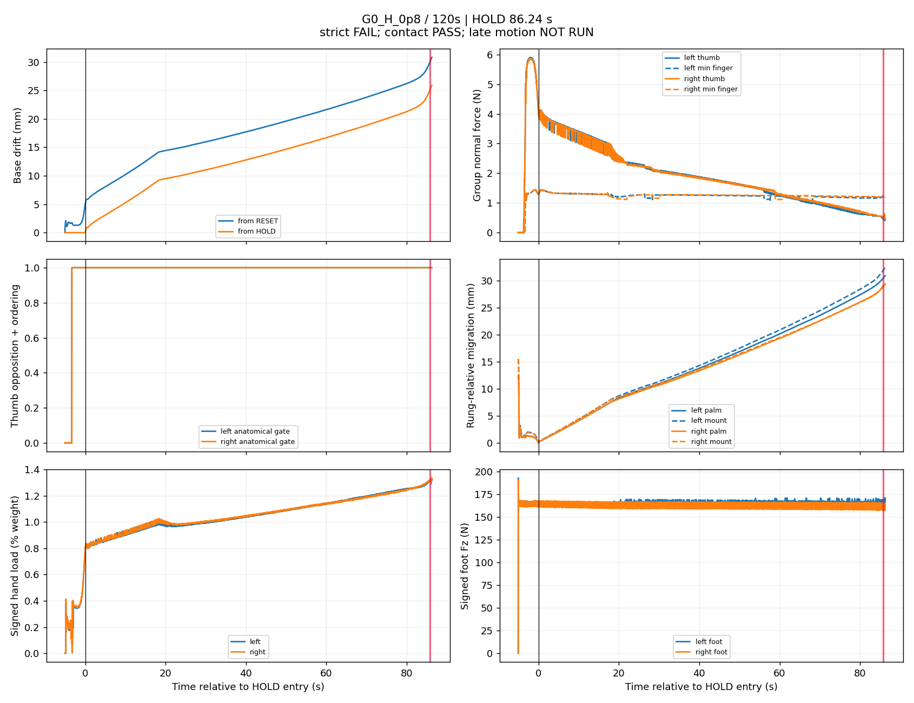
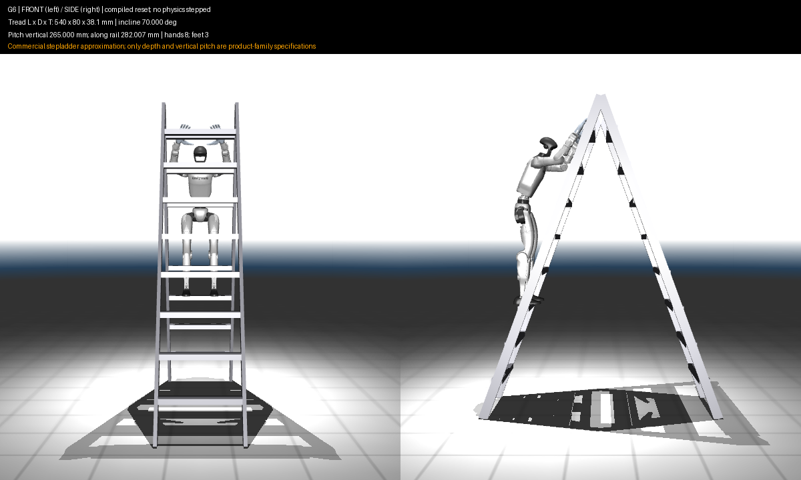

# Ladder geometry and friction outcomes

**No condition qualifies for a physically valid, stable 120-second HOLD.** The bounded campaign completed 25 distinct screens, eight 60-second attempts and six nominal 120-second attempts, including the reproduced original. All 39 ledger records completed without a technical trial error. No condition was eligible for the fresh repeat or 0.0005 s confirmation, so both stages are NOT RUN. This is a negative physical result, separate from software verification.

| Nominal 120-second attempt | Achieved HOLD | Strict terminal cause | Thumb-specific contact gate |
|---|---:|---|---|
| G0 native reference, μ=1.8 | 88.02 s | drift | PASS |
| G0 H, μ=0.6 | 83.78 s | drift, left/right hand gates | FAIL |
| G0 M, μ=0.6 | 83.02 s | drift, left/right hand gates | FAIL |
| G0 M, μ=0.8 | 85.76 s | drift | FAIL |
| G0 H, μ=0.8 | 86.24 s | drift | PASS |
| G0 M, μ=1.2 | 87.50 s | drift | FAIL |

Every nominal long attempt ends before the 90–120 s matched window. Its final-window late-motion result is therefore NOT RUN, not PASS. There are no duration-only 120-second passes and no reset-infeasible geometries. G0 H μ=1.2 passes 60 seconds but is not selected within the long budget; its 120-second result is NOT RUN. All other tested conditions fail at a recorded stage. Untested geometry/friction combinations remain NOT RUN.

## Geometry findings

The original G0 scene and balanced reset reproduce the reviewed 30-second and long reference traces exactly: 1,753 and 4,654 physical trace rows agree. The original long attempt fails drift at 88.02 seconds of HOLD. The controller, robot, hand assets and strict thresholds were preserved. All geometry conditions found a feasible deterministic reset before dynamics; no condition was selected using its achieved HOLD duration.

| Geometry | Frozen hand/foot rung | Surface change from G0 | Native screen outcome |
|---|---|---|---|
| G0 | 11/4 | unchanged | 30 s strict/contact PASS; late motion FAIL |
| G1, thickness only | 11/4 | top −15.95 mm, bottom +15.95 mm | 0.50 s; both hands fail opposition |
| G2, depth only | 11/4 | approach face +15 mm | 0.50 s; joint limits and knee contact on tread 5 |
| G3, depth and thickness | 11/4 | approach face +15 mm, top −15.95 mm | 0.50 s; knee contact and both hands fail opposition |
| G4, pitch only | 9/4 | foot-rung center anchored; 250 mm along rail | 0.50 s; joint limits |
| G5, LadderMan geometry | 6/1 | published six-rung geometry | 0.50 s; drift; contact-quality gate also fails |
| G6, commercial approximation | 8/3 | eight treads per side; 265 mm vertical pitch | 0.50 s; right knee contacts front tread 4 |

The reset rule translates the root and support targets with the compiled front/top faces, then solves both legs and arms inside their original ranges. It preserves wrist orientation, waist lean, grasp targets, preload and 0.36 m hand-target separation. Thus G1–G3 isolate rung dimensions under the same declared face-relative adaptation; they do not test an independently retuned grasp. Exact reference qpos inspections are saved separately. G5/G6 cannot reuse reference hand rung 11, and G4's unchanged reference qpos misses the moved hand targets.

Thinner and shallower rungs do **not** improve the original grasp under this reset rule. G1 and G3 have zero minimum thumb normal force on both sides. Their maximum recorded contact-centroid migrations during the achieved HOLD are 0.697 and 1.817 mm; small movement does not imply valid opposition. G2 retains thumb-specific contact quality (minimum thumb forces 4.92/4.64 N) and has only 0.385 mm maximum contact migration, but fails on knees and joint limits. These are 0.5-second early-failure observations, not substitute 20–30 second averages.

Increased pitch does not establish a collision or load-distribution improvement. G0 and G4 both have zero prohibited-support steps in their native screens, and G4 fails joint limits after 0.50 s despite valid hand contact. No matched window exists for G4. Its extended rails and increased overall dimensions are reported as a controlled pitch diagnostic, not a commercial product.

The commercial approximation does **not** reach a long attempt. All eight tested G6 conditions fail the 30-second screen, with prohibited right-knee support on tread 4. H at 0.6/0.8/1.2 and all three M cases pass the anatomical contact gate but still fail strict physical acceptance. Native 1.8 and H at 0.4 also fail contact quality. Neither high friction nor a low RESET-drift value over 0.5 s overrides these failures. Rear treads and rails remain collidable; their presence does not expand the accepted support set.

## Hand-only versus whole-tread friction

All eight G0 screen conditions pass strict/contact acceptance at 30 s but fail late motion. At 60 s, H μ=0.4 fails after 49.02 s with drift and both hand gates failing; first opposition-loss crossings precede drift. The other seven conditions pass strict/contact acceptance but fail late motion. The published ranking selects H μ=0.6/0.8 and M μ=0.6/0.8/1.2 for five new long diagnostics, alongside the imported original reference. H μ=1.2 has no long slot and must not be reported as a failed or passed 120-second trial.

G5 fails drift/contact quality at every tested coefficient. G6 fails unintended support at every tested coefficient. Mu values are sensitivity levels, not measured materials, and this sweep does not establish monotonic behavior.

For G0, the matched 20–30 s H/M comparisons show similar foot support and hand loading:

| Effective μ | H mean RESET drift, mm | M mean RESET drift, mm | H total hand weight share | M total hand weight share |
|---|---:|---:|---:|---:|
| 0.6 | 15.327 | 15.342 | 1.974% | 1.978% |
| 0.8 | 15.175 | 15.184 | 1.972% | 1.974% |
| 1.2 | 15.017 | 15.019 | 1.968% | 1.969% |

Mean signed foot vertical reactions are about 164 N per foot. Across these H/M pairs, maximum measured foot slip is below 0.157 mm/s; the individual means/maxima and signed forces are retained in `results.json`. No side crosses the declared 50% relative hand-load-change flag. The small H/M differences here are therefore not accompanied by a large measured unloading change, but the hands carry only about 2% of body weight combined. These results provide no hand capacity qualification. G6 has no completed matched interval, so its H/M averages are NOT RUN.

The completed 50–60 s windows show the same limited H/M distinction. Mean RESET drift for H/M is 20.811/20.854 mm at μ=0.6, 20.621/20.650 mm at μ=0.8, and 20.471/20.482 mm at μ=1.2. Combined hand weight shares are 2.241/2.248%, 2.234/2.239%, and 2.229/2.230%, respectively. These are matched-duration observations, not proof of convergence or load capacity.

## Evidence and limitations

The campaign source is frozen at `5886277`; raw run directories and ledger checksums remain immutable. Parameterization preserves all 471 reviewed compiled arrays/reset fields. H at 1.8 reuses native G0/G5/G6 only after compiled contact-model equivalence checks. Every promoted run starts from a fresh reset with acquisition and assistance removal.

An export-only defect affected the first run in fresh worker processes: MuJoCo's global `mj_saveLastXML` selected the auxiliary reference ladder compiled during reset adaptation. The simulated environment and runtime model fingerprints were correct. Every original export is preserved; `reconstructions/<run_id>/proof.json` identifies affected exports. The reconstructed owned XML and binary model are checked against the frozen source/assets, recorded reset qpos, robot/solver/controller fingerprints, compiled ladder and material audit. All model arrays agree after owned-XML round trip. Use the reconstructed model for replay, not an affected original scene. Reconstruction integrates no dynamics and changes no physical result.

The two imported pre-refactor reference runs retain the reviewed every-physics-step boolean external-force audit and detailed arrays in event windows. They do not contain the new full-step array stream. All new campaign trials store actual `qfrc_applied` and `xfrc_applied` arrays at every scored physics step. This reference logging limitation is explicit rather than filling missing files with synthesized samples.

Earlier acquisition transitions initially had event timestamps and control-rate traces, while detailed physics windows covered HOLD entry and failure. Separate acquisition-prefix reproductions now supply those missing windows for all 25 screen conditions. Each stops 0.26 s after HOLD entry; all 266 control rows match the corresponding original physical states, contacts, support reactions and failure fields exactly. Their 1 ms windows cover INITIALIZE, ACQUIRE, REMOVE_ASSISTANCE and HOLD transitions. These supplements carry no qualification result, do not replace a failure, and cannot affect reset selection or promotion. They are archived under `acquisition_windows/` with their source identities and checksums.

[MATRIX.md](MATRIX.md) distinguishes tested screens from untested geometry/material combinations; [COMPARISON.md](COMPARISON.md) and [comparison.csv](comparison.csv) include each duration; [failure_timeline.csv](failure_timeline.csv) reports first crossing and persistence onset with phase and time base. [promotions.json](promotions.json) preserves the prelaunch rankings, selected conditions and exact run identities. Plots include acquisition, HOLD entry, drift, anatomical contacts, migration and signed support loads. Compiled front/side views preserve true dimensions. Recorded-state videos use offline forward kinematics and do not advance or qualify physics.

The G0 H μ=0.8 long diagnostic retains valid contact while drift grows to failure. Its final-window assessment remains NOT RUN:

The G6 reset view shows the actual modeled dimensions and selected supports:

Also retained here: [original long-reference plot](figures/G0_reference_120s.png) and [G1 thin-rung screen plot](figures/G1_screen.png). The archive contains all 39 run plots, HOLD-entry/failure views, seven geometry views and representative recorded-state videos.

## Recommendation

Keep the current project default. The next single hypothesis to test is that G6's selected support placement drives the right knee into tread 4 during assistance removal. A predeclared reset that maintains knee clearance through that transition, with the original controller unchanged, would isolate whether this acquisition failure is masking a viable grasp. This campaign does not establish that such a reset exists or that it would solve long-term drift. Controller redesign, load transfer, release and capacity testing remain separate work.
