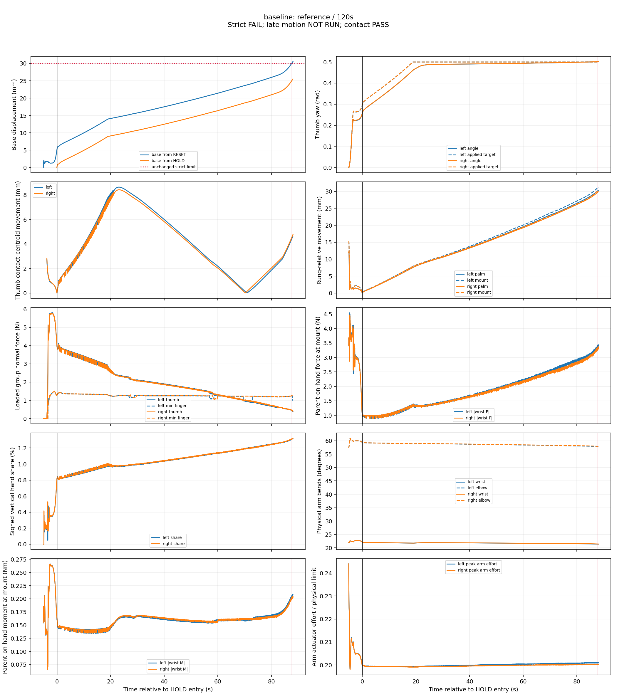
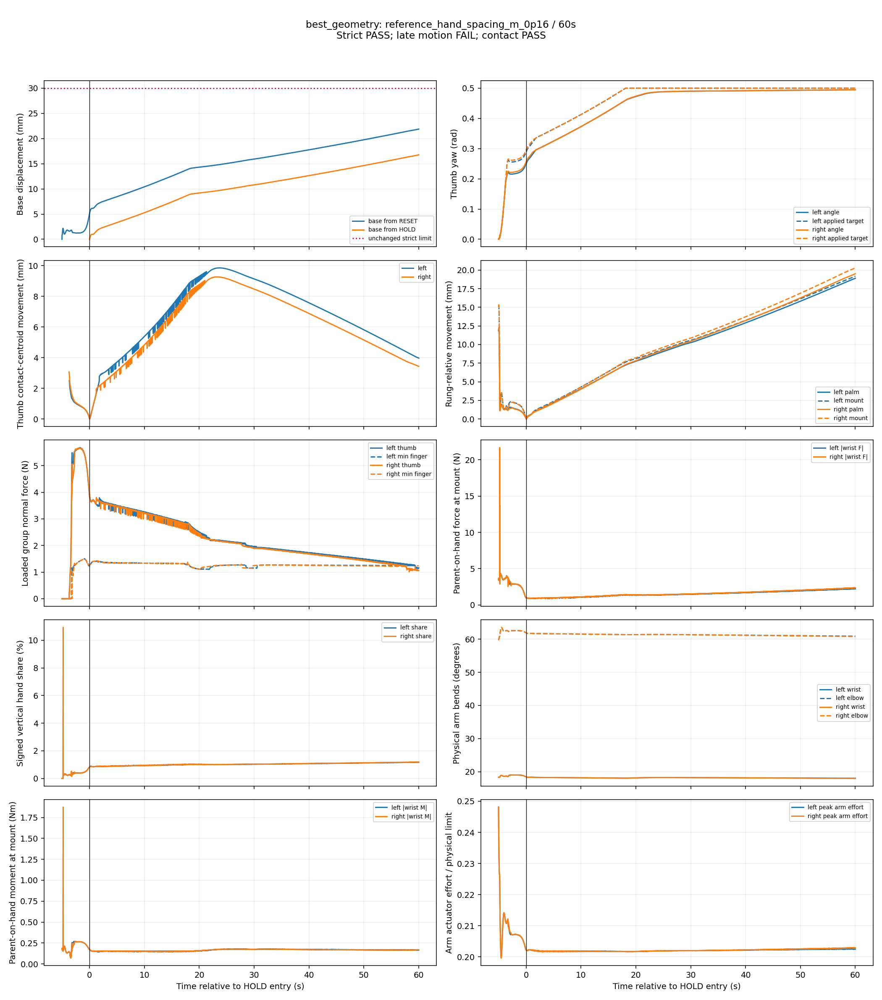
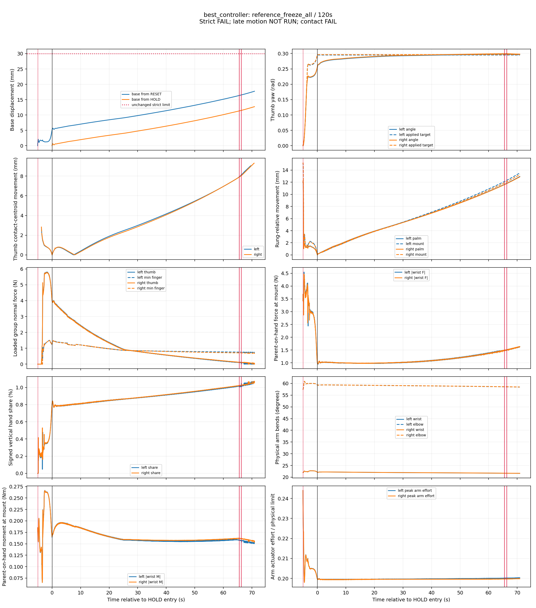
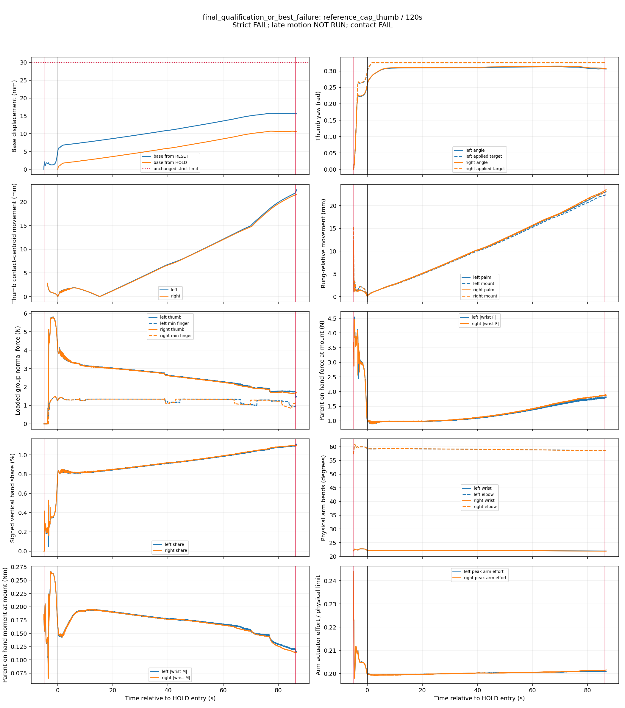

# Measured pose-search outcomes

No candidate completes the full 120-second qualification. The bounded campaign is complete; the original default and all physical/evaluator limits remain unchanged. Software verification passes, while physical progression remains blocked.

## Does moving both hands to rung 10 help?

No, in the tested four-support stance. The direct rung-10 reset is reachable (about 5.865 micrometres arm IK position error), but acquisition drives the thumb IP joints beyond the unchanged limit-error threshold. The strict evaluator aborts after 0.50 s HOLD. Thumb-specific contact quality is still valid at that abort; the failure must not be described as a successful grasp or an infeasible reset. Its 60/120 s stages are NOT RUN.

The compiled rung-11-minus-rung-10 displacement is [0.07000, 0, 0.18666] m in world coordinates. Lowering the hands changes horizontal reach as well as height. Achieved-HOLD peak wrist bend rises from about 22.13 to 28.15 degrees, and elbow bend from about 59.35 to 100.45 degrees. Arm effort fraction is lower (about 0.16 versus 0.20), but this is not a useful support improvement: mean signed hand forces are -0.532/-0.523 N, with feet at 169.022/167.564 N against 334.336 N robot weight. These means cover different achieved durations; there is no matched 20–30 s load comparison for the aborted rung-10 case.

Both split-rung controls also fail joint limits (7.76/8.00 s). Narrower rung-11 spacing improves wrist bend to about 18.40 degrees, with actual mount separation 0.319995 m versus 0.359994 m for the reference. It completes 60 s but does not improve the reference's overall late-motion score. The 0.40 rad waist pose unloads the hands by more than 50% and later contacts rung 10 with its wrist housing; it fails unintended support at 49.86 s. Its smaller base drift is not grasp qualification.

## What causes the observed movement?

The controlled evidence supports a combination, rather than a unique arm-first or finger-only cause. C1/C2/C3 and the bounded arm intervention share exactly the same 253 physical acquisition rows with their parent. Thumb freezing reduces reference 30 s maximum base drift from 15.722 to 8.568 mm, with palm migration falling from about 10.6 to 7.2–7.3 mm. Freezing all targets reduces palm migration further to about 5.4 mm and improves the worst motion ratio, but thumb force decays and both long C2 trials lose opposition around 70 s. C1 and C3 also eventually lose opposition despite much lower base drift.

Motion continues under stationary references. In the original long run, thumb targets are fixed at 0.50 rad after 30 s while wrist mounts move an additional 20.63/19.85 mm before the 88.02 s drift failure. The declared bounded arm correction worsens its parent's 30 s base drift to 20.941 mm. That intervention does not establish arm motion as the first cause or rule out arm compliance. Contact migration, moving wrist/palm poses, and changing wrist wrench remain coupled. Continued closure contributes to early creep, but simply removing it sacrifices later seating/opposition. Loaded contact alone is insufficient: thumb-specific opposing geometry must survive.

[Controlled 30 s comparisons](CONTROLLED_COMPARISON.md) distinguish interventions with identical acquisition from preload/closing-target comparisons that also change acquisition. The hands carry roughly 2% of weight in the matched reference window; these are coupled, predominantly foot-supported stances, not independent hand-capacity demonstrations.

## Which candidate qualifies?

None. All six first-120 s attempts fail the unchanged strict evaluator before the requested duration. A final requested 30 s late-motion assessment is therefore NOT RUN for those attempts, not a convergence pass. The shorter strict/contact passes all fail late motion.

| Candidate | Achieved HOLD (s) | Max RESET drift (mm) | Terminal reason | Contact quality |
|---|---:|---:|---|---|
| Original rung-11 reference | 88.02 | 30.546 | drift | PASS |
| Reference + thumb cap (C3) | 86.72 | 15.739 | left_hand | FAIL |
| Reference + C1 | 81.02 | 13.205 | left_hand | FAIL |
| 0.16 m spacing + thumb freeze (C1) | 80.18 | 13.834 | left_hand | FAIL |
| Reference + freeze all targets (C2) | 70.92 | 17.745 | left_hand | FAIL |
| 0.16 m spacing + C2 | 70.14 | 18.578 | left_hand, right_hand | FAIL |

The original reference lasts longest in this set, but fails drift. The best modified long attempt is the thumb cap, which fails left-hand opposition at 86.72 s despite only 15.739 mm maximum RESET drift. No lower-drift candidate is promoted after losing opposition. Fresh 120 s repeat and 0.5 ms comparison are NOT RUN because no nominal finalist qualifies. Robustness is BLOCKED. Capacity and hand-transfer prerequisites remain unmet; no load transfer, release, climbing or PPO was attempted.

## What experiment is justified next?

A separately budgeted, single-law test should use thumb opposition and rung-relative contact migration to decide when to adjust the thumb reference, keeping one measured rung-11 parent, all other control laws, actuator limits and evaluator thresholds fixed. Compare it against the original law and the fixed thumb cap. The measured tradeoff is maintaining seating without indefinitely advancing the reference; regulating normal force alone would miss geometrically invalid contact. Any candidate still needs the full nominal/repeat/fine qualification before robustness or a default change.

## Campaign accounting and evidence

- Geometry: 28 of at most 32 configurations, including four infeasible alternate IK resets. No additional seed search or unsupported combination. Spacing/offset/tilt semantics and actual transforms are saved per run.
- Controllers: 12 of 12 combinations. Conditional C6 replaces one higher-preload slot, based on saved stationary-target wrist-motion evidence.
- Screens: 36 physical 30 s attempts plus four infeasible reset inspections. Promotions: 12 of 12 at 60 s; six of six first 120 s attempts. No physical technical retries.
- Finalists/repeat/fine: none eligible. Robustness: zero, BLOCKED. Optional boundary-condition diagnostics: zero, NOT RUN; the controlled coupled interventions can be interpreted without a fixture or replayed support wrench. Existing free-wrist failures do not gate this campaign.
- Every scored physics step is audited for actual applied-force arrays. All are zero. Prohibited contacts remain recorded in failed runs; they are never counted as valid support.

[Full ranked table](COMPARISON.md), [flat numeric table](comparison.csv), [resolved results and first crossings](results.json), [software/physical verification](verification.json), [work log](WORK_LOG.md), and [archive/checksum receipt](artifact.json). The archive includes original failed trials, source revisions and dirty diffs, portable equivalent scenes, physical assets, physics event windows, and offline recorded-state videos. Previous archives are preserved.

Representative figures show the most advanced completed attempt of each selected candidate, including later failures. The baseline has its own panel; geometry and modified-failure panels prefer alternatives. 'Best controller' identifies the best eligible shorter-duration motion score and then displays that candidate's later failure; it is not a qualified controller.

