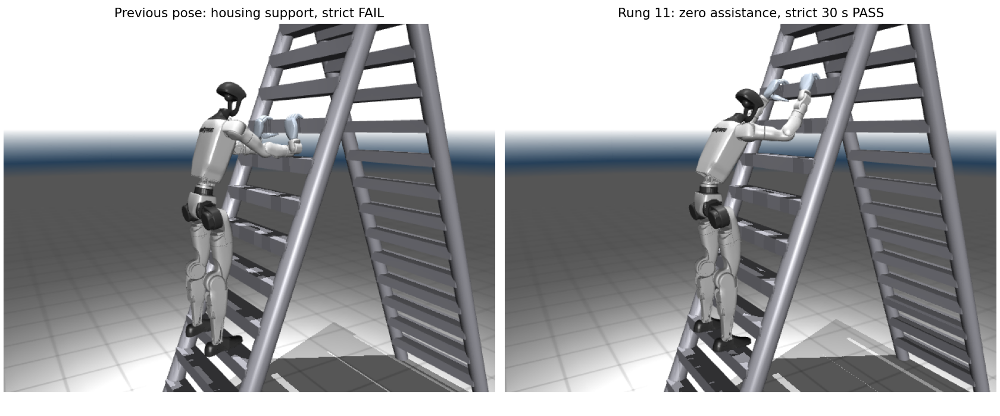
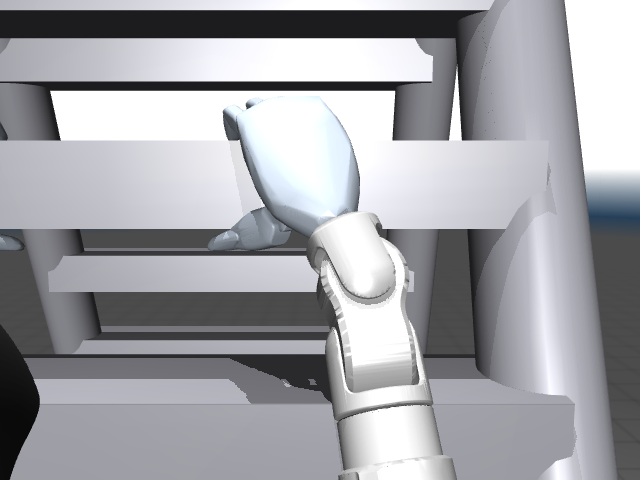
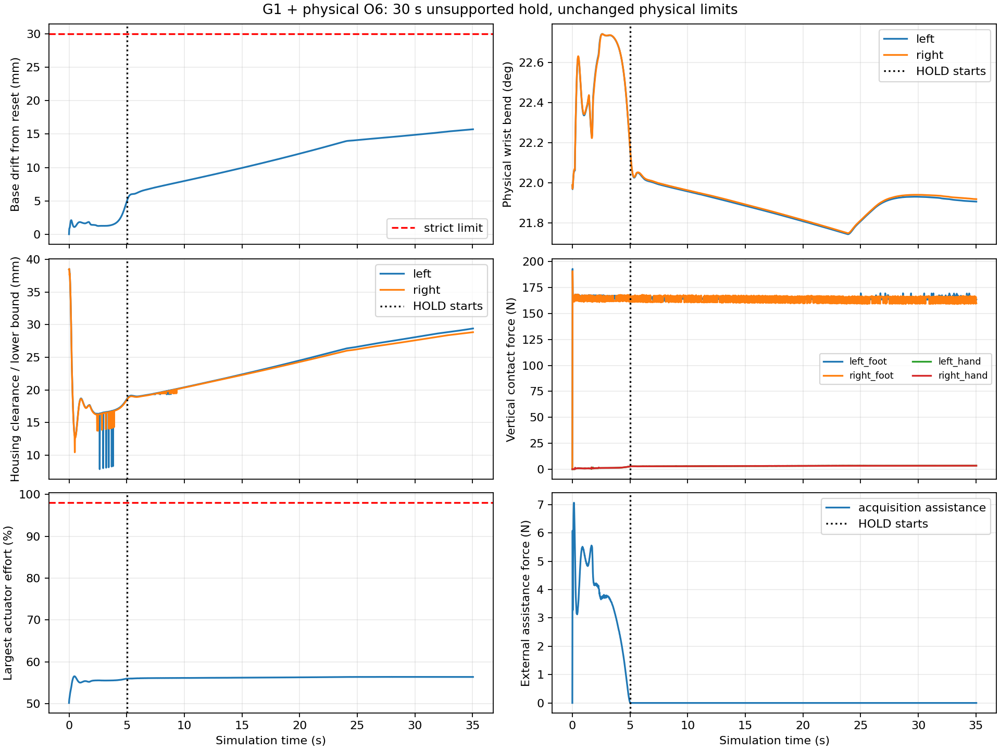

# Balanced thumb-below G1 / O6 grasp

The opt-in `thumb-below-balanced` preset uses both hands on rung 11 and both feet on rung 04. The thumbs contact the underside and all four fingers contact the upper face. It keeps the wrists near 22 degrees of physical bend, away from their joint stops. The historical `baseline` and `thumb-below` presets are unchanged.

```powershell
conda run --no-capture-output -n teleopit python -m teleopit.sim.g1_o6 --posture thumb-below-balanced --viewer --output outputs/g1_o6/balanced_viewer
```

Space pauses/resumes the simulation. Contact normals remain off by default. The balanced preset ends at `HOLD_COMPLETE` after a full strict unsupported interval; it does not attempt release/reacquisition. Use `--video` instead of `--viewer` to save a labeled MP4. For the longer verification:

```powershell
conda run --no-capture-output -n teleopit python -m teleopit.sim.g1_o6 --posture thumb-below-balanced --config docs/g1_o6/posture/hold_30s.json --output outputs/g1_o6/balanced_30s
```

## What changed

The waist leans forward by 0.3 rad from the existing stance, the hands move to rung 11, and reset IK searches within +/-0.7 rad of wrist pitch/yaw. These are search bounds; the physical joint ranges are unchanged. The hand orientation uses a 50-degree rotation of the standalone rung-grasp reference and a (-23, 0, -20) mm grip offset. The resulting elbows remain moderately bent; the pose avoids the old combination of nearly straight elbows and approximately 96-degree wrist bend.

Gravity compensation is supplied through the existing position servos: reference targets include `(gravity_torque - foot_load_torque) / kp`. The approximate foot-load model places equal vertical loads under the reference COM. Actual support forces still come exclusively from MuJoCo contacts. Reset initializes this static preload before physics starts; subsequent position commands retain the original 1 rad/s rate limit and actuator clipping.

Finger closure stops advancing its target more than `0.12 Nm / kp` beyond the measured joint angle. This reduces commanded squeeze while retaining the original 0.35 Nm effort limit. Acquisition retains the existing bounded pelvis pose stabilizer, but removes its full-body gravity lift so the feet carry weight from the start. The entire scored HOLD has exactly zero assistance. This is a four-contact ladder stance, with most weight carried by the feet; it is not a demonstration of hanging the robot's full weight from its hands.

No masses, inertias, meshes, collision masks, friction, mimic constraints, solver parameters, joint ranges, servo gains, actuator limits or strict success thresholds were changed. No weld or kinematic state reset is applied during physics stepping. The training environment and standalone hand experiment are unchanged.

## Measured qualification

Implementation revision: `fa0a1d8` (CPU MuJoCo 3.8.1, conda `teleopit`). The 30 s tests retain every original threshold; only the requested hold duration is extended.

| Trial | Step (ms) | Unsupported hold (s) | Verdict | Maximum drift (mm) | Maximum wrist bend (deg) |
|---|---:|---:|---|---:|---:|
| nominal | 1 | 10.02 | PASS | 9.96 | 22.13 |
| repeat | 1 | 10.02 | PASS | 9.96 | 22.13 |
| long | 1 | 30 | PASS | 15.72 | 22.13 |
| fine | 0.5 | 30.02 | PASS | 15.72 | 22.12 |
| body_offset | 1 | 10.02 | PASS | 9.77 | 21.55 |
| legacy | 1 | 0.5 | FAIL | 35.90 | — |
| baseline | 1 | 0.5 | FAIL | 94.71 | — |

All five balanced qualifications have zero housing-contact physics steps and exactly zero applied assistance during HOLD. The minimum certified/measured housing clearance during HOLD is 18.55 mm; peak actuator effort is 56.44% of the unchanged limits. Every scored sample has thumb-below/fingers-above contacts. The two nominal traces are byte-identical. All 278 baseline control records are identical to the prior diagnostic baseline.







Vector plot: [hold_evidence.pdf](hold_evidence.pdf). The labeled 30 s MP4 is in the raw-evidence archive.

## Evidence and scope

See [results.json](results.json) for measured qualification results and [search.csv](search.csv) for rejected alternatives. The full experiment history and validation details are recorded in [WORK_LOG.md](WORK_LOG.md) and [validation.json](validation.json). The raw-log archive and its checksum are described in [artifact.json](artifact.json).

The search compared hand rungs 09–12, split rungs 10/11, crouches, torso lean, grip orientation and finger preload. Lowering the pelvis caused knee collisions. Merely moving the arms retained finger saturation, missing thumb opposition and housing support. Motor gravity preload fixed the load-transfer problem; changing grip orientation and initializing preload before stepping removed the housing contact. Earlier 0.18 Nm closing commands passed 10 s but lost thumb opposition during a 30 s extension; that stronger command was rejected.

Each balanced run saves the compiled scene, asset hashes, resolved configuration and grasp parameters, signed wrist traces, control targets, contact identities and posture measurements. The original strict gates remain authoritative. Additional posture evidence checks physical wrist/elbow angles, joint-stop margins, housing clearance against every ladder rung/rail, and actual loaded thumb/finger contact heights. These additional measurements are at the 20 ms control interval; qualification also audits housing contacts at physics-step resolution.

MuJoCo 3.8.1 sometimes reports exactly zero mesh distance for clearly separated pairs in this scene. This resembles the independently reported [upstream distance-query issue](https://github.com/google-deepmind/mujoco/issues/3383). The read-only clearance audit uses a 0.1 m cutoff and, only for exact-zero returns, computes a conservative separating-plane lower bound from the compiled mesh/box vertices. It labels that method explicitly. Negative distances and actual simulated contacts are never suppressed, and the physics engine/settings remain unchanged.

The results establish a deterministic CPU MuJoCo holding preset under the current provisional physical parameters. Release, rung-to-rung climbing, broad disturbance robustness and hardware feasibility remain unverified.
