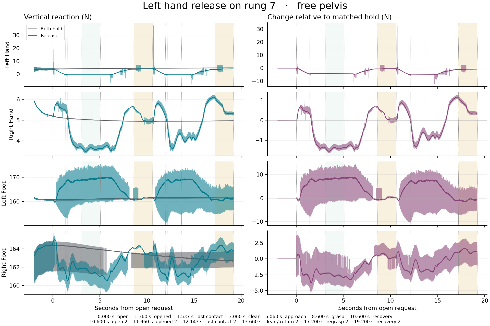
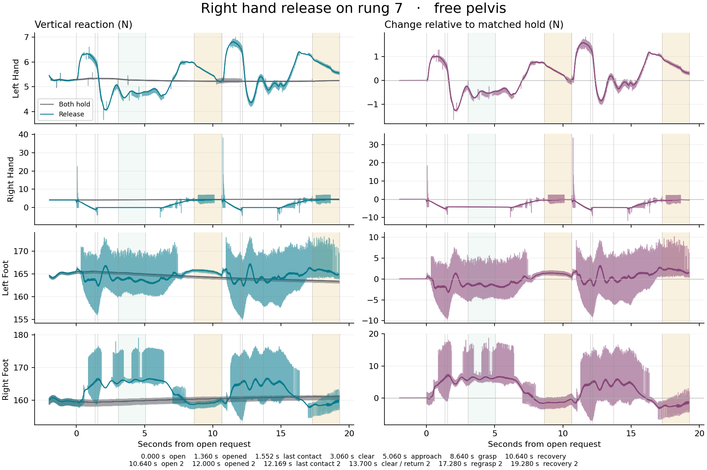

# Free-pelvis release and regrasp on rung 7

The follow-on experiment starts from the same measured four-contact state on every run and checks the weight on each limb from preparation through the final regrasp. [Unassisted weight redistribution](../rung7_redistribution/README.md)

Both hands completed the full floating-base cycle twice in CPU MuJoCo. On every 1 ms sample, the opposite thumb remained opposed, its four fingers retained loaded contact above rung 7, and both feet retained contact on rung 2. Applied assistance, fixture wrench and other external vertical reactions were zero throughout measurement. Both hands also retained their grasps throughout each matched hold control.

## Loads after regrasp

The entries are mean upward reactions over the final two seconds after the second verified grasp. Each release and its control share the same clock window. Repeats from reset produced identical native force traces.

| Moving hand | Branch and window | Left hand, N | Right hand, N | Left foot, N | Right foot, N |
| --- | --- | ---: | ---: | ---: | ---: |
| Left | Release, 32.74–34.74 s | 3.92 | 5.58 | 160.89 | 163.95 |
| Left | Both hold, same window | 4.86 | 4.97 | 161.78 | 162.72 |
| Right | Release, 32.82–34.82 s | 5.83 | 4.19 | 165.55 | 158.78 |
| Right | Both hold, same window | 5.24 | 4.58 | 163.47 | 161.05 |

| Moving hand | Final reaction or change | Left hand | Right hand | Left foot | Right foot |
| --- | --- | ---: | ---: | ---: | ---: |
| Left | Release share, % body weight | 1.17 | 1.67 | 48.12 | 49.04 |
| Left | Change from release baseline, N | +0.05 | +0.16 | −0.07 | −0.14 |
| Left | Change after subtracting matched drift, N | −0.94 | +0.61 | −0.90 | +1.22 |
| Left | Matched change, percentage points | −0.28 | +0.18 | −0.27 | +0.37 |
| Right | Release share, % body weight | 1.74 | 1.25 | 49.52 | 47.49 |
| Right | Change from release baseline, N | +0.55 | +0.06 | +0.51 | −1.11 |
| Right | Change after subtracting matched drift, N | +0.59 | −0.38 | +2.08 | −2.27 |
| Right | Matched change, percentage points | +0.18 | −0.12 | +0.62 | −0.68 |

The left release returned all four loads to within 0.16 N of its own baseline. The largest remaining difference after the right release was 1.11 N at the right foot. Relative to the simultaneous control, the right release left 2.08 N more at the left foot and 2.27 N less at the right foot. Holding alone also moved the foot loads over these intervals, by up to 1.57 N. These are repeatable differences for this initial state and controller.

## Contact and wrist evidence

Each grasp required 500 consecutive native samples with the thumb below rung 7 and all four fingers loaded above it, followed by 2,000 uninterrupted hold samples. Each retreat required 500 consecutive samples with measured opening, zero external hand contacts and at least 5 mm clearance. The first retreat was followed by a further 2,000 samples fully clear. The position and orientation errors below were measured at the close requests.

| Moving hand | Wrist error on first / second return | Angle error on first / second return | Minimum clearance on first / second retreat | Minimum opposing-thumb normal load | Peak slip at a required support |
| --- | ---: | ---: | ---: | ---: | ---: |
| Left | 0.60 / 0.64 mm | 0.0023 / 0.0022 rad | 12.42 / 12.25 mm | 3.70 N | 2.35 mm/s |
| Right | 0.77 / 0.99 mm | 0.0018 / 0.0025 rad | 15.08 / 14.60 mm | 3.40 N | 1.03 mm/s |

The position and angle limits were 3 mm and 0.035 rad. The slip threshold was 20 mm/s. Peak pelvis drift was 13.97 mm for left release and 12.99 mm for right release, below the 30 mm limit. During the second opening the net external force exceeded the 25 N static-balance threshold for one native sample on each release, at 26.242 s on the left (34.22 N) and 26.285 s on the right (34.51 N). No support loss accompanied either event. Both post-grasp holds remained within the monitor limits. The contact-continuity count and the stricter all-monitor count are both available in the [cycle table](cycles.csv).

| Pelvis | Moving hand | Nominal moving-hand cycles completed | Opposite hand and both feet continuously supported |
| --- | --- | ---: | ---: |
| Fixed, original experiment | Left | 2/2 | 0/2 |
| Fixed, original experiment | Right | 2/2 | 0/2 |
| Free, revised controller | Left | 2/2 | 2/2 |
| Free, revised controller | Right | 2/2 | 2/2 |

## Controller and comparison

The reference uses G6 geometry, a floating pelvis, a 34.081102 kg robot and Earth gravity. The first 12.04 s include the existing acquisition and right-wrist feedback. The controller then ramps stance impedance over 1.5 s and measures two continuous seconds with both hands and both feet loaded. The open request occurs at 15.54 s. Acquisition assistance has already reached zero.

The stance uses twice the reference proportional gain at hips and knees and three times the gain at ankles and waist. Derivative gains scale with the square root of those ratios. Each neutral target moves toward its measured joint angle as stiffness increases, preserving the joint's static preload at capture. Both branches use the same 15 stance targets and the same gains. Motor force ranges, contact geometry, friction and gravity retain their source values. Each `resolved.json` records acquisition and scored model identities, commanded gains and torque limits.

The supporting arm keeps its captured joint equilibrium and applies 23% of the arm correction calculated in the rung frame. Its six physical O6 servos use bounded preload of 0.20, 0.12 and 0.26 N·m for thumb flexion, thumb rotation and each of the four finger flexors, respectively. The released hand opens at 0.67 and closes at 0.55 closure units/s. After confirmed regrasp it captures its attained wrist equilibrium and uses 0.16, 0.12 and 0.20 N·m on those same groups. In the hold control, restating the fixed rung target preserves the closed wrist's equilibrium throughout. All joint commands pass through the existing joint limits, delay and slew limiter.

## Force measurements

Vertical reactions are signed world-frame forces on the robot at the intended rungs. Positive values act upward. The body-weight denominator is 334.3356 N. Each new pair uses its own last two seconds before opening as baseline. The release effect subtracts the change measured over the same clock interval in its both-hands-holding control. The historical reference carried 5.13 N at the left hand and 4.54 N at the right. [Original reference](../rung7_regrasp/README.md)

During the two seconds fully clear the released hand supplied exactly 0 N. The same-side foot took the largest increase. On left release the extra 8.26 N at the left foot also offset unloading of the right hand and foot. On right release the extra 6.18 N at the right foot offset unloading of both hands and the left foot.

| Moving hand | Change while clear relative to control | Left hand | Right hand | Left foot | Right foot |
| --- | --- | ---: | ---: | ---: | ---: |
| Left | N | −4.31 | −1.42 | +8.26 | −2.53 |
| Left | Percentage points of body weight | −1.29 | −0.42 | +2.47 | −0.76 |
| Right | N | −0.53 | −4.20 | −1.44 | +6.18 |
| Right | Percentage points of body weight | −0.16 | −1.26 | −0.43 | +1.85 |

The per-window table includes both openings and retreats, the two-second fully clear interval, and both two-second holds. It gives mean loads and body-weight shares in each branch, changes from baseline, matched effects, and native extrema. [Paired forces](paired_forces.csv) · [Repeat summary](paired_repeats.csv)

The independent sum over signed geom-pair forces reproduced all four native force traces exactly. Across all scored windows, the largest difference between mean vertical net force and the measured vertical momentum change per second was 0.0000032 N. The two branches matched for all 777 control ticks through the open request, and the largest applied stance-target difference over a pair was 0 rad. [Verification](verification.json)

The green band spans the fully clear measurement. The gold bands span the two measured post-grasp holds. In each figure the left column shows upward force at each support and the right column shows its change relative to the matched hold. The thin traces retain the native transients.

[Reproduction and Viser commands](COMMANDS.md) · [Raw-contact audit](native_audit.json) · [Events and momentum balance](matched_events.json) · [Raw file hashes](raw_sha256.json) · [Work log](WORK_LOG.md)
