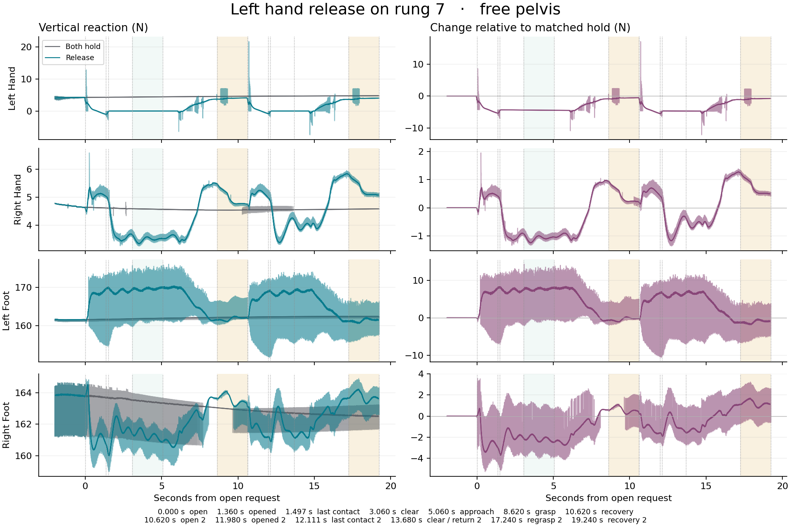
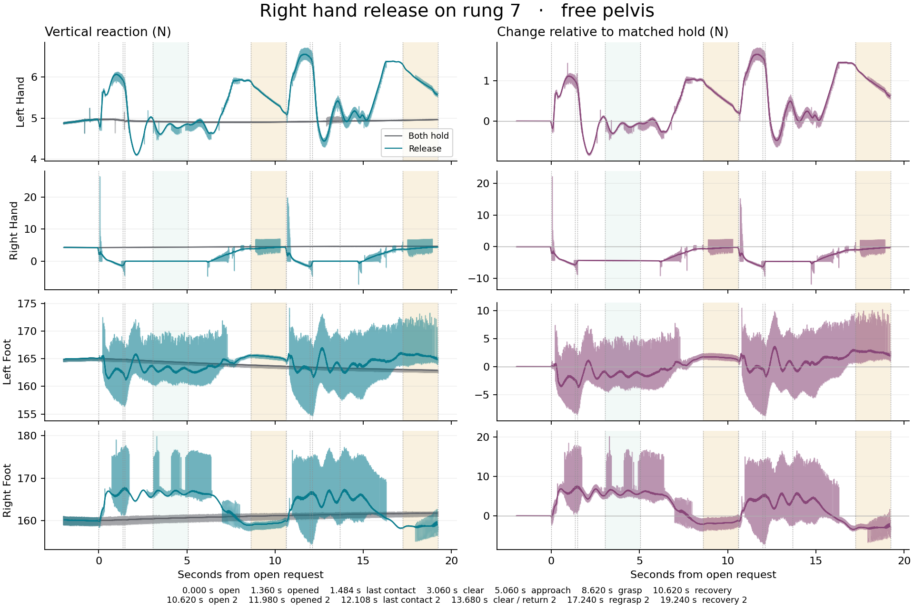

# Unassisted weight redistribution on rung 7

Both hands completed two release–retreat–regrasp cycles in each of two nominal repeats. Every release and both-hands-holding control passed from its first 1 ms physics step through its last. Both feet remained on rung 2. The opposite thumb stayed opposed below rung 7 with all four fingers loaded above it. All external assistance, applied generalized forces, fixture reactions and unintended vertical support were zero.

## Where the released load went

The released hand carried exactly 0 N throughout each two-second clear interval. On left release, the left foot gained 7.66 N relative to the matched hold (2.29 percentage points of body weight). The right hand changed by −1.09 N and the right foot by −2.15 N. On right release, the right foot gained 5.90 N (1.76 points). The left hand changed by −0.13 N and the left foot by −1.37 N.

The robot weighed 334.3356 N. The historical four-support reference averaged 5.13 N at the left hand and 4.54 N at the right. Each release here uses its own two-second pre-opening mean and the contemporaneous hold control. Positive reactions act upward on the robot. The small negative hand means during retreat are downward reactions before detachment. [Reference force evidence](../rung7_regrasp/reference.json)

### Mean release-branch reaction, N (% of body weight)

| Moving hand | Window | Left hand | Right hand | Left foot | Right foot |
| --- | --- | ---: | ---: | ---: | ---: |
| Left | Before opening | 4.18 (1.25) | 4.70 (1.41) | 161.61 (48.34) | 163.85 (49.01) |
| Left | Opening 1 | 0.40 (0.12) | 5.03 (1.50) | 167.31 (50.04) | 161.59 (48.33) |
| Left | Retreat 1 | −0.07 (−0.02) | 3.83 (1.15) | 169.06 (50.57) | 161.51 (48.31) |
| Left | Fully clear | 0.00 (0.00) | 3.49 (1.04) | 169.57 (50.72) | 161.29 (48.24) |
| Left | After first regrasp | 3.95 (1.18) | 4.98 (1.49) | 161.84 (48.41) | 163.57 (48.92) |
| Left | Opening 2 | 0.61 (0.18) | 5.08 (1.52) | 166.82 (49.90) | 161.79 (48.39) |
| Left | Retreat 2 | −0.05 (−0.02) | 3.98 (1.19) | 168.52 (50.40) | 161.88 (48.42) |
| Left | After final regrasp | 3.88 (1.16) | 5.31 (1.59) | 161.40 (48.28) | 163.75 (48.98) |
| Right | Before opening | 4.93 (1.47) | 4.28 (1.28) | 165.04 (49.36) | 160.09 (47.88) |
| Right | Opening 1 | 5.72 (1.71) | 0.19 (0.06) | 163.19 (48.81) | 165.22 (49.42) |
| Right | Retreat 1 | 4.75 (1.42) | −0.08 (−0.02) | 163.45 (48.89) | 166.21 (49.71) |
| Right | Fully clear | 4.78 (1.43) | 0.00 (0.00) | 163.07 (48.77) | 166.50 (49.80) |
| Right | After first regrasp | 5.49 (1.64) | 4.15 (1.24) | 165.34 (49.45) | 159.35 (47.66) |
| Right | Opening 2 | 6.16 (1.84) | 0.06 (0.02) | 163.76 (48.98) | 164.34 (49.15) |
| Right | Retreat 2 | 5.14 (1.54) | −0.10 (−0.03) | 164.00 (49.05) | 165.30 (49.44) |
| Right | After final regrasp | 5.91 (1.77) | 4.09 (1.22) | 165.56 (49.52) | 158.76 (47.49) |

### Release effect relative to matched hold, N (percentage points of body weight)

Each entry subtracts the control's change from the release's change over the same interval. Both branches had identical loads before opening. The two independent resets per side gave identical recorded force trajectories. The between-repeat range was 0 N throughout. Over the clear window, the largest drift at any control support was 0.41 N in the left pair and 0.60 N in the right pair. These repeats describe one deterministic starting pose and seed. [Per-run loads, changes from each baseline, matched effects and transient extrema](paired_forces.csv) · [Repeat ranges](paired_repeats.csv)

| Moving hand | Window | Left hand | Right hand | Left foot | Right foot |
| --- | --- | ---: | ---: | ---: | ---: |
| Left | Before opening | 0.00 (0.00) | 0.00 (0.00) | 0.00 (0.00) | 0.00 (0.00) |
| Left | Opening 1 | −3.88 (−1.16) | +0.40 (+0.12) | +5.64 (+1.69) | −2.17 (−0.65) |
| Left | Retreat 1 | −4.40 (−1.31) | −0.77 (−0.23) | +7.29 (+2.18) | −2.13 (−0.64) |
| Left | Fully clear | −4.40 (−1.32) | −1.09 (−0.32) | +7.66 (+2.29) | −2.15 (−0.64) |
| Left | After first regrasp | −0.65 (−0.19) | +0.44 (+0.13) | −0.40 (−0.12) | +0.61 (+0.18) |
| Left | Opening 2 | −4.02 (−1.20) | +0.54 (+0.16) | +4.50 (+1.35) | −1.04 (−0.31) |
| Left | Retreat 2 | −4.72 (−1.41) | −0.57 (−0.17) | +6.14 (+1.84) | −0.86 (−0.26) |
| Left | After final regrasp | −0.88 (−0.26) | +0.73 (+0.22) | −1.07 (−0.32) | +1.22 (+0.36) |
| Right | Before opening | 0.00 (0.00) | 0.00 (0.00) | 0.00 (0.00) | 0.00 (0.00) |
| Right | Opening 1 | +0.76 (+0.23) | −4.08 (−1.22) | −1.78 (−0.53) | +5.09 (+1.52) |
| Right | Retreat 1 | −0.18 (−0.05) | −4.39 (−1.31) | −1.29 (−0.39) | +5.85 (+1.75) |
| Right | Fully clear | −0.13 (−0.04) | −4.38 (−1.31) | −1.37 (−0.41) | +5.90 (+1.76) |
| Right | After first regrasp | +0.59 (+0.18) | −0.39 (−0.12) | +1.61 (+0.48) | −1.81 (−0.54) |
| Right | Opening 2 | +1.25 (+0.37) | −4.52 (−1.35) | +0.22 (+0.07) | +3.03 (+0.91) |
| Right | Retreat 2 | +0.21 (+0.06) | −4.72 (−1.41) | +0.61 (+0.18) | +3.89 (+1.16) |
| Right | After final regrasp | +0.95 (+0.28) | −0.56 (−0.17) | +2.58 (+0.77) | −2.99 (−0.89) |

### Distribution after the final regrasp

| Moving hand | 2 s after final regrasp | Left hand, N | Right hand, N | Left foot, N | Right foot, N |
| --- | --- | ---: | ---: | ---: | ---: |
| Left | Release | 3.88 | 5.31 | 161.40 | 163.75 |
| Left | Both hold | 4.76 | 4.58 | 162.47 | 162.53 |
| Left | Change from release baseline | −0.31 | +0.61 | −0.20 | −0.10 |
| Left | Change from control baseline | +0.57 | −0.12 | +0.86 | −1.32 |
| Right | Release | 5.91 | 4.09 | 165.56 | 158.76 |
| Right | Both hold | 4.95 | 4.65 | 162.97 | 161.76 |
| Right | Change from release baseline | +0.98 | −0.18 | +0.52 | −1.33 |
| Right | Change from control baseline | +0.03 | +0.38 | −2.07 | +1.67 |

Four-support contact recovered on both sides. The largest final difference from each release's own baseline was 0.61 N for left release and 1.33 N for right release. Compared with the matched hold, the final left-foot / right-foot changes were −1.07 / +1.22 N after left release and +2.58 / −2.99 N after right release. The hold control itself moved individual loads by up to 2.07 N across the reported windows. These control drifts are appreciable beside the few newtons carried by a hand. The same-side foot gains during clearance exceed that drift. The smaller post-grasp differences are specific to this matched initial condition.

## Physical stability

The separate two-second baseline ran from 5.00 to 7.00 s. In its own release trial each hand reached verified clearance at 10.06 s, stayed clear until 12.06 s, and returned to the rung under its own joint servos. The final hold ran from 24.24 to 26.24 s on both sides. Each grasp had 500 native samples of verified opposition followed by 2,000 uninterrupted hold samples. Each retreat had at least 500 consecutive samples with measured opening, no external moving-hand contact and at least 5 mm clearance. No required support slipped or lost contact.

| Moving hand | Minimum clearance, first / final (mm) | Wrist error, first / final (mm) | Angle error, first / final (rad) | Minimum supporting-thumb normal (N) | Peak net force, release / control (N) |
| --- | ---: | ---: | ---: | ---: | ---: |
| Left | 12.17 / 12.31 | 0.58 / 0.61 | 0.0022 / 0.0019 | 4.09 | 17.92 / 13.50 |
| Right | 15.26 / 14.73 | 0.91 / 1.10 | 0.0019 / 0.0020 | 3.35 | 22.91 / 13.50 |

The 3 mm position, 0.035 rad orientation, 30 mm pelvis drift and 25 N whole-robot net-force limits held. The peak release pelvis drift was 15.10 mm. Peak slip at the continually required supports during measurement was 1.90 mm/s. The peak at the returning hand during confirmed grasp and hold was 17.86 mm/s, below the 20 mm/s threshold. The net-force limit includes horizontal reactions and gravity. [All native checks](native_audit.json) · [Window clocks and vertical impulse balance](matched_events.json)

## Model, controller and matching

The trial restores the same four-contact frame at 12.04 s of the verified G6 reference for both sides and both branches. The original reference used assistance for its earlier acquisition. Each new run starts from the measured positions, velocities and actuator targets with force, moment and disturbance capacities zero, through the five-second preload interval, the two-second baseline and the release cycles. The pelvis has six free degrees of freedom. The ten model equalities couple internal O6 finger joints. There are no world fixtures, mocap bodies, tendons or body gravity compensation.

The 41 actuators remain finite-force joint servos. The stance controller ramps hip and knee stiffness to twice the original value and ankle and waist stiffness to three times the original value, preserving captured joint preload. For the first seven seconds, including the baseline, the twelve finger targets are limited to 0.045 rad/s to build support without breaking a grasp. At the end of preparation the closed wrist captures its current applied targets against the new measured rung goal. Opening halves the moving wrist's captured contact preload while retaining its rung target and gravity compensation torque from the arm servos. Both hands and both feet then react to their actual measured motion. Within each pair the two branches applied identical targets to all 15 stance channels on every tick, with zero commanded weight shift.

Release and control matched for all 350 pre-opening servo ticks, including joint positions, velocities and applied controls. Summing the signed native geom-pair forces independently reproduced each of the four reaction traces with zero error. Across all windows the maximum difference between mean net vertical force and measured vertical momentum change per second was 1.4e-06 N. [Model, state and repeat checks](verification.json) · [Raw recording hashes](raw_sha256.json)

## Force traces

The thin traces retain the 1 ms transients. The darker curves average 101 samples. Green marks the fully clear interval and gold marks each two-second hold. The left column shows absolute reaction and the right column shows change relative to the matched hold.

[Trial and Viser commands](COMMANDS.md) · [Controller experiments and verification log](WORK_LOG.md) · [Earlier fixed-pelvis cycles](../rung7_regrasp/README.md)
