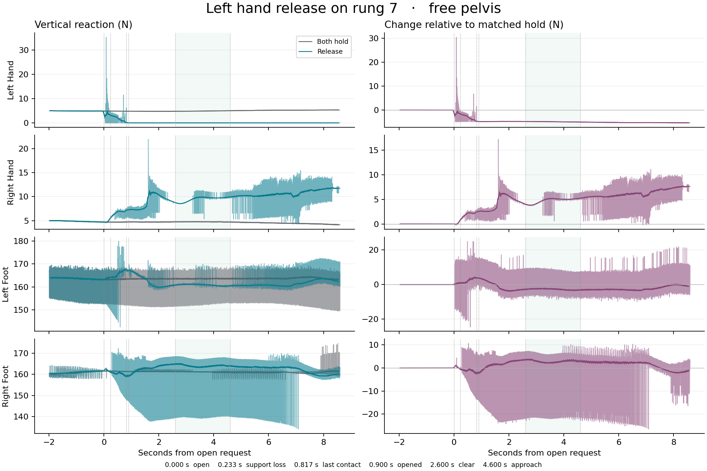
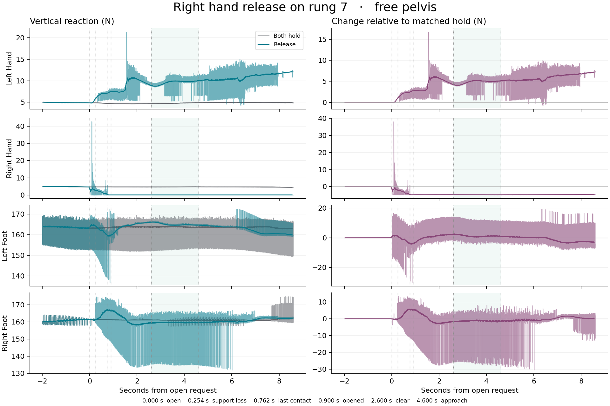

# Commanded O6 regrasp on G6 rung 7

With the pelvis fixed, each moving hand completed both grasps on rung 7. The opposite thumb briefly lost opposition in every run, so no trial passed the continuous-support criterion. With the pelvis free and assistance at zero, each hand opened, cleared rung 7 and stayed clear for 2 s. The opposite thumb lost opposition during opening. Both feet stayed on rung 2 as the pelvis drifted, and neither moving hand reached its return pose to regrasp.

## Cycle outcomes

Each nominal trial was repeated from reset. A moving-hand pass requires two separate 0.5 s confirmations of loaded opposition, each followed by an uninterrupted 2 s hold, with a verified release between them. The final column reports a separate condition on the other three supports.

| Pelvis | Moving hand | Nominal moving-hand cycles | Minimum gap over the 0.5 s release confirmation | Other supports and recovery |
| --- | --- | ---: | ---: | --- |
| Fixed | Left | 2/2 | 15.8 mm | Both feet stayed loaded. The right thumb first lost opposition at 18.587 s on the simulation clock. The left hand completed both holds. |
| Fixed | Right | 2/2 | 18.4 mm | Both feet stayed loaded. The left thumb first lost opposition at 18.646 s. The right hand completed both holds. |
| Free | Left | 0/2 | 22.2 mm | The right thumb lost opposition 0.233 s after the open request. The return timed out with 85.7 mm wrist position error. |
| Free | Right | 0/2 | 27.3 mm | The left thumb lost opposition after 0.254 s. The return timed out with 88.7 mm wrist position error. |

The fixed-cycle gaps refer to the release between the two grasps. The free-cycle gaps refer to the release from the matched four-support hold. The 20 mm retreat command produced 20.4 and 21.0 mm of outward motion on the second fixed release, and 32.2 and 35.1 mm on the first floating release. The latter measurements include base motion. The fixed pelvis moved less than 0.1 µm and rotated less than 1.1 µrad during the nominal cycles. Its fixture supplied a mean upward reaction of 110.84 N for left-hand motion and 110.95 N for right-hand motion.

The floating open request occurred at 12.040 s in all four release/control pairs. Each hand met the encoder opening criterion after 0.900 s. Final external hand contact ended after 0.817 s on the left and 0.762 s on the right. Both reached verified clearance after 2.600 s. Reapproach began after 4.600 s and timed out after 8.600 s. In left/right release order, the reference's 25 N static force-residual limit was first crossed after 0.082/0.086 s. The opposite hand first exceeded the 20 mm/s slip limit after 0.824/0.739 s, the pelvis crossed the 30 mm drift limit after 1.115/1.088 s, and peak pelvis displacement reached 73.4/74.4 mm. Both trajectories ended upright with both feet on rung 2. The smallest instantaneous foot reaction across these runs was 132.1 N, and maximum foot slip stayed below 1.3 mm/s. Both matched controls retained all four supports through the timeout.

Both fixed hands also completed the moving-hand cycle at −2 mm and +2 mm along the tread. These were discrete trials at three positions. The opposite grasp briefly lost confirmation at all three positions. Individual trajectories include minimum certified gaps, handoff command changes, drift, fixture force and the first time each monitored limit was crossed. [Cycle table](cycles.csv) · [Trial outcomes](outcomes.json) · [Matched events and momentum balance](matched_events.json)

## Where the vertical load went

The replayed 30 s control averaged 5.13 N at the left hand and 4.54 N at the right. In the actual 2 s pre-open baselines the four reactions averaged **4.92, 4.86, 163.67 and 160.90 N**, in left-hand, right-hand, left-foot and right-foot order. Robot weight was 334.34 N. Each pair had 602 identical pre-command control ticks, including positions, velocities, queued targets and applied commands. All 15 leg and waist commands matched through the comparison. Applied assistance and other external contact forces were zero throughout scoring.

Each cell gives the release branch's change from its own baseline minus the corresponding control change, in **N (percentage points of body weight)**. The control uses the release branch's event times. Both repeats gave the same native force traces. The clear window covers 2 s of physical detachment, starting after the 0.5 s confirmation.

| Released hand | Window after request | Left hand | Right hand | Left foot | Right foot |
| --- | --- | ---: | ---: | ---: | ---: |
| Left | Opening, 0–0.9 s | −2.83 (−0.85) | +1.53 (+0.46) | +2.01 (+0.60) | −0.85 (−0.25) |
| Left | Retreat and confirmation, 0.9–2.6 s | −4.78 (−1.43) | +4.22 (+1.26) | −1.11 (−0.33) | +1.74 (+0.52) |
| Left | Hand clear, 2.6–4.6 s | −4.89 (−1.46) | +4.76 (+1.43) | −2.75 (−0.82) | +2.88 (+0.86) |
| Right | Opening, 0–0.9 s | +1.60 (+0.48) | −3.00 (−0.90) | −1.01 (−0.30) | +2.25 (+0.67) |
| Right | Retreat and confirmation, 0.9–2.6 s | +4.41 (+1.32) | −4.69 (−1.40) | +0.50 (+0.15) | −0.15 (−0.05) |
| Right | Hand clear, 2.6–4.6 s | +4.81 (+1.44) | −4.71 (−1.41) | +1.25 (+0.37) | −1.35 (−0.40) |

During the clear window the opposite hand supplied almost the entire lost vertical reaction even though its thumb had already lost opposition. The feet changed their split in opposite directions. These are transient loads on a drifting robot. A settled three-support split and recovery of the four-support distribution could not be measured. There was also a short force increase on the opening hand before final contact loss. The native peaks were 35.3 N on the left and 42.8 N on the right. The vertical impulse from all external reactions and gravity agreed with the change in whole-robot vertical momentum to within 0.00002 N of mean force over every reported window.

The per-repeat table includes raw means and body-weight shares for both branches, changes from each branch's own baseline, corrected changes, and native extrema. The repeat table gives the range across deterministic resets. [Per-support forces](paired_forces.csv) · [Repeat variability and peaks](paired_repeats.csv)

The pale traces show native 1 ms samples, the darker curves show 101 ms averages, and the green shading marks the requested clear hold. Repeat traces coincide. [Left plot data](left_forces.npz) · [Right plot data](right_forces.npz)

## Controller and measurements

The opt-in CPU entry point is `PhysicalHands.install(env)` on a fresh right-wrist G6 reference. `policy.step(arms=(left_arm, right_arm), grip=(left_rate, right_rate))` advances one 20 ms tick. Each arm takes seven joint targets in the resolved actuator order. Each grip takes a finite rate clamped to [−1, 1], with one second of integrated travel at full rate. Zero holds the current target. A `None` channel uses live reference feedback on that side. Explicit digit actions can reach only the six named O6 servos on their hand. The physical closing law limits preload, opening starts at the encoders, and all commands pass through the G1 actuator bounds, 1 rad/s slew limit and command queue. The returned `physical_hands` observation includes both wrists' rung-relative poses and twists, measured digit angles, previous rates and contact details. Both environment and policy resets clear the action state.

The script first acquires both hands and feet. A world-to-pelvis weld holds all six base degrees of freedom in fixed mode. Free mode loads the verified floating model. After 2 s of simultaneous support with zero assistance and active right-wrist feedback, the first release establishes the physically reached open starting pose. The paired floating measurement uses that release, its clear hold and its attempted regrasp. The remainder of the full cycle requires reaching the approach gate. The script keeps the selected wrist target fixed in the rung frame during opening in both branches, transfers arm and finger ownership explicitly, and recaptures the attained wrist pose and thumb landmark on return to reference control. A scratch-data IK commands the servos throughout. The supporting hand continues to use its measured reference feedback.

At each physics step, a grasp needs the intended geometry, a loaded thumb below the tread, all four loaded fingers above it and an opposing normal pair. The normal-load threshold is 0.05 N. Opening needs all six encoders within 0.1 rad of open and at least 0.1 rad of measured motion. Release additionally needs zero external hand contacts, at least 5 mm of scene-wide signed clearance and measured outward travel. The 0.5 s confirmation resets on a single failed native sample. All intended rung contacts, including subthreshold loads, contribute their signed world-vertical force. Other external forces, the fixture wrench and internal wrist wrenches have separate fields.

The left air probe closed by 1.346 rad with zero loaded external surfaces. The right wrong-surface probe closed by 0.856 rad against physical rung 6 while the requested target was rung 7. Neither produced a verified rung-7 grasp. Per-step geometry IDs, loads, normals, slip speeds and forces are in each run's `contacts.npz`. The model name table and thresholds are in `resolved.json`. [Reproduction commands](COMMANDS.md) · [Work log](WORK_LOG.md) · [Reference verification](reference.json) · [Raw evidence hashes](raw_sha256.json)
