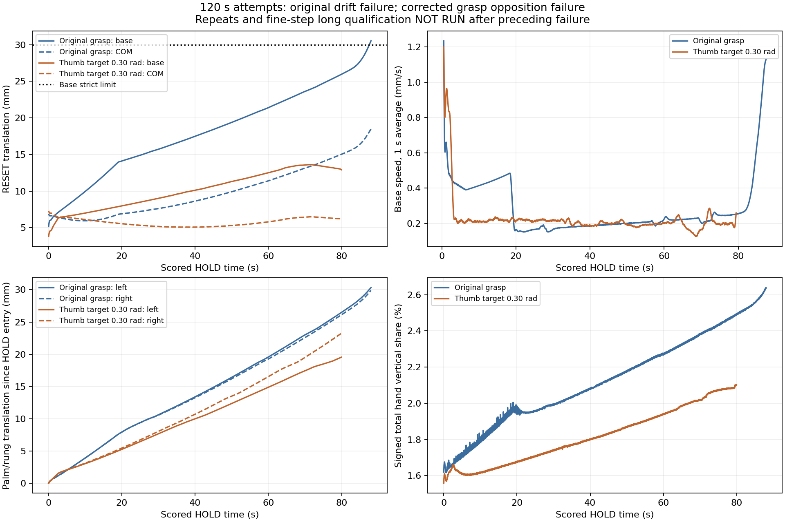
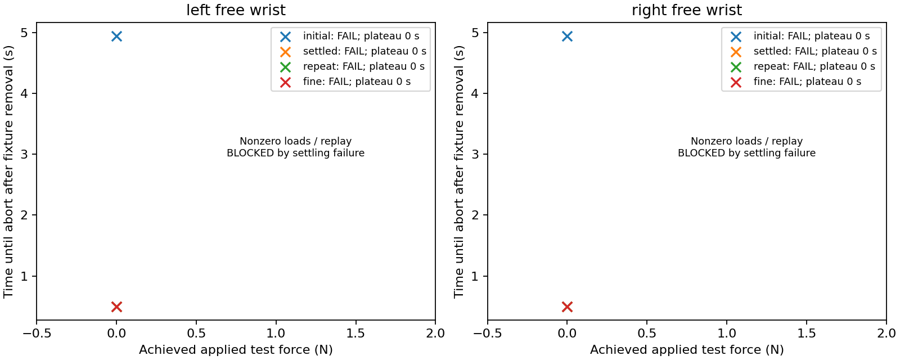
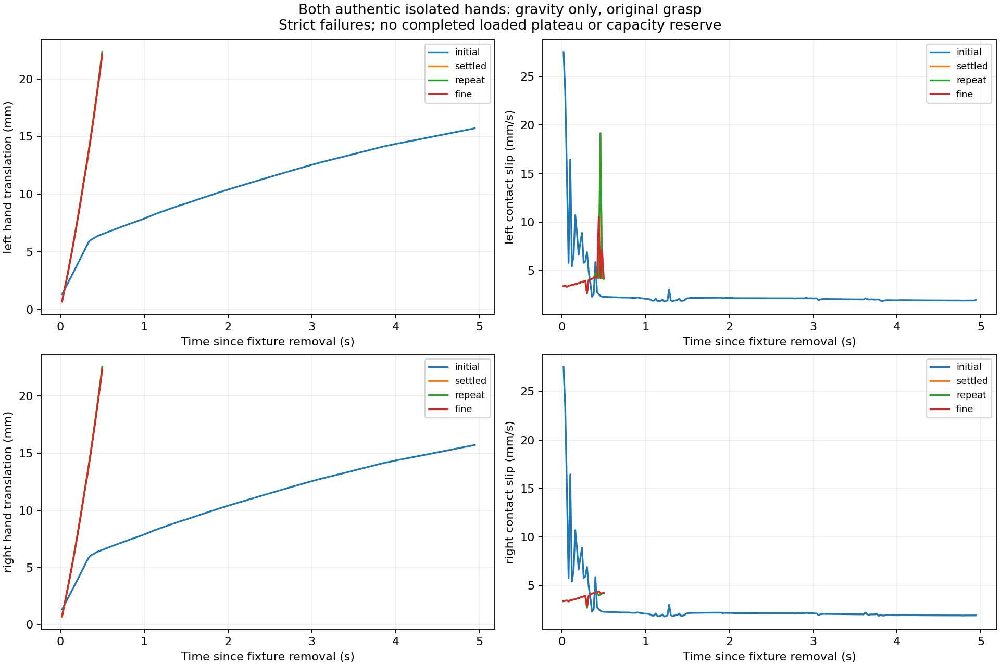

# Support validation and same-rung hand transfer

Implemented on `dex-hand-exp` using conda `teleopit`. The default holding experiment remains unchanged. The new experiments are explicit, prerequisite-gated commands in `teleopit.sim.g1_o6_support`.

**Physical progression is blocked.** The original grasp passes 60 s but fails the 120 s attempt on cumulative RESET drift. The single declared thumb-target correction reduces drift but loses left-hand opposition. Both authentic isolated hands also fail gravity-only free-wrist settling/retention. No physical load transfer, unloading, release or reacquisition was attempted on this failed basis.

| Stage | Software | Physical result | Progression |
|---|---|---|---|
| 0: current baseline and opening | PASS | 30 s before/after/final controls byte-identical; both hands close/reopen with gravity on/off | PASS |
| 1: long HOLD and convergence | PASS | Original 60 s PASS; 120 s FAIL after 88.02 s. Corrected 60 s PASS; 120 s FAIL after 79.92 s | FAIL |
| 2: isolated capacity | PASS | Both sides FAIL at zero additional load, including settled-state correction, repeat and 0.5 ms comparison; no loaded plateau | FAIL |
| 3: measured hand loading | PASS: accounting, bounded feedback, guards, integration checks | BLOCKED by stages 1/2 | No |
| 4: closed-hand unloading/reload | PASS: measured reduction, reference floor, compensation and persistence | BLOCKED | No |
| 5: opening, retraction, three supports | PASS: independent opening, scratch IK, active-rung/scene clearance | BLOCKED | No |
| 6: reacquisition and cycles | PASS: approach/close/opposition/reload/post-hold protocol and cycle guards | BLOCKED | No |

Software PASS means implementation and the scoped checks below passed. It does not establish that the blocked controllers can execute their intended physical maneuver. Fine-step/repeat 120 s qualification, nonzero isolated load families and replay are **NOT RUN / BLOCKED** after their preceding failures. Release/reacquisition and commanded-versus-measured transfer traces therefore do not exist. The observed hand-share trace below is from holding only.

## Measured results

| Grasp / requested HOLD | Strict | Achieved HOLD (s) | Maximum RESET drift (mm) | Final RESET drift (mm) | Final requested 30 s convergence |
|---|---|---:|---:|---:|---|
| Original / 60 s | PASS | 60.02 | 21.403 | 21.403 | FAIL |
| Original / 120 s | FAIL: drift | 88.02 | 30.546 | 30.546 | NOT RUN |
| Thumb yaw target 0.30 / 30 s | PASS | 30.00 | 9.009 | 9.009 | FAIL |
| Thumb yaw target 0.30 / 60 s | PASS | 60.02 | 12.511 | 12.511 | FAIL |
| Thumb yaw target 0.30 / 120 s | FAIL: left opposition | 79.92 | 13.620 | 12.917 | NOT RUN |

The original first drift crossing occurs at simulator time 92.576 s; abort occurs at 93.06 s. The corrected first opposition loss occurs at 84.474 s; abort occurs at 84.96 s. Acquisition/removal precede HOLD and do not count toward its duration. The original control-step persistence calculation is preserved; physics event times can precede/follow its discrete samples by one control interval.

The separate convergence criterion requires <=0.05 mm/s translation slope and <=2 mm position excursion in the final 30 s, plus the declared orientation limits. In the 30–60 s window the original base slope/excursion are 0.1904 mm/s / 5.680 mm; corrected values are 0.1166 mm/s / 3.513 mm. Maximum hand slope/excursion are 0.3126 mm/s / 9.305 mm and 0.2834 mm/s / 8.581 mm respectively. COM and both hand rotations are also assessed. This is not asymptotic stability.



Both initial-state isolated hands abort at 10.94 s, 4.94 s after fixture removal. Their first scored slip violation is at 6.02 s. The one predeclared correction uses the coupled run's measured settled mount and finger state, with zero reset velocities and bounded servo preload; both hands then lose opposition during fixture removal and abort at 6.50 s. Fresh repeats and 0.5 ms cases also fail. Every case achieves **0 s of loaded plateau** and no additional applied test wrench. Retention at an earlier sample does not establish full-plateau retention.




The coupled feet carry roughly 98% of robot weight at the 30 s baseline; the hands carry about 2%. The two failed isolated initializations reject the premise that this grasp retains a free wrist under its own gravity without parent support. Continuing thumb motion and palm/rung creep correlate with the long-hold failures; the logs do not identify a unique causal mechanism. The original and corrected grasps have separate results; the correction was not promoted to the default.

## Commands

Run from the repository root. Use fresh output directories. The full [command reference](COMMANDS.md) covers duration/repeat/fine runs, isolated tests, all transfer modes and report/video generation.

```powershell
conda run --no-capture-output -n teleopit python -m teleopit.sim.g1_o6_support long-hold --seconds 60 --output outputs/g1_o6/new_support/hold_60s
conda run --no-capture-output -n teleopit python -m teleopit.sim.g1_o6_support capacity-matrix --source-run outputs/g1_o6/support_transfer/control_before --state settled --prior-trials 2 --output outputs/g1_o6/new_support/capacity
conda run --no-capture-output -n teleopit python -m teleopit.sim.g1_o6_support transfer --mode load --target-share 0.05 --evidence docs/g1_o6/support_transfer/evidence.json --output outputs/g1_o6/new_support/load_05
```

The supplied evidence book makes transfer commands return `BLOCKED` before constructing a simulator. No bypass flag exists. To qualify future work, list the actual new run paths in a separate evidence book. The gate checks run hashes, configuration/controller/asset identity, nominal/repeat/fine 120 s results, isolated simultaneous wrench reserve and preceding side/duration/cycle outcomes. A provisional physical transfer pass requires new isolated tests for its observed wrist demands before it authorizes another stage. Checkout paths are excluded from physical identity; asset hashes remain included.

## Implementation and physical contract

The static evaluator and all physical parameters remain unchanged. The new controller adds slow, bounded joint-target feedback from signed external contact Fz. A regularized compliance solve coordinates body targets, preserves the force total, limits offsets to 0.08 rad and updates to 0.005 rad/s, and disables integration near effort or physical command limits. Stage 3 additionally audits support-location motion within 2 mm. Assigned forces are logged separately and never count as measured load.

Unloading uses a 2 s reference, initial selected Fz >=5 N, >=80% reduction, wrist force/moment <8 N / 0.4 Nm, compensating support reactions within 2 N, 0.5 s continuous guard and 2 s unloaded hold. Opening starts from measured angles and affects only the selected hand. Retraction uses a 20 mm world-X trajectory over 5 s, 0.05 rad/s arm command limit, original joint ranges and scratch-data IK; the live simulator moves only through servos. Release requires measured opening, no external hand contact and >=5 mm scene-wide clearance. Reacquisition requires actual intended-rung opposition/order and sustained measured reload. Every phase has a timeout; any failed interval prevents the next maneuver.

Physics-step audits inspect actual applied-force arrays, housing/unintended contact and numerical/physical events. Optional selected-hand load-bearing gates are excluded only in declared unload/detach phases; slip, geometry and prohibited contacts remain audited. The RESET drift reference never changes. All-link momentum-rate balance supplements the original static residual. Internal wrist forces are not external support forces.

The isolated protocol retains authentic left/right models and their own gravity. Its sole scored applied force is the declared world-fixed wrench at the current wrist mount. It uses simultaneous settled/peak-force/peak-moment source samples, never component-wise peak combinations. Acquisition, fixture removal, 2 s settling, 3 s ramp, 10 s plateau, 3 s ramp down and 10 s recovery are separate. The matrix includes scales 0.5/1/1.5/2, a tested 1.2 reserve, local boundary refinement, repeats/fine cases and conditional recorded replay, within 48 trials per side, 50 N and 3 Nm. These are experimental bounds, not measured payload capacities. Here, zero-load failure blocks all later loading.

## Evidence and reproduction

- [Results and late-window measurements](results.json), [frozen experimental specification](specification.json), [work log](WORK_LOG.md), [software verification](verification.json).
- [Downloadable raw evidence release](https://github.com/maximbess/Teleopit/releases/tag/g1-o6-support-2026-11-12), with ZIP and SHA256 sidecar; [publication receipt](artifact.json) records exact revision, URL, size and checksum.
- The archive includes raw control/physics logs, failures, initial/resolved states, compiled scenes, event/extrema reports, source snapshot for the pre-commit 60 s run, asset files/hashes, plots and both failed-run replay videos. Original scene bytes and manifests are retained as `scene_original.xml` / `manifest_original.json`; the executable scene changes file references only. All public numeric model/solver fields are compared before/after relocation, excluding filename offsets and path/buffer storage sizes.

Clone the repository, check out `implementation_revision` from `evidence_manifest.json`, and extract the archive into that checkout. Verify the ZIP SHA256 and its per-file manifest before using the source-run paths. Use the recorded dependency versions and conda `teleopit`. Assets needed to compile the recorded scenes and rebuild the current robot/hands are included. Earlier diagnostic, posture and consolidation archives remain untouched.

Verification: 235 affected tests pass; 30 s control logs/summaries are byte-identical; both-hand gravity-on/off free closing/reopening passes. The unavailable crapper/dryer/mutator tools were replaced transparently by Radon + statement coverage, scoped AST comparison and nine targeted in-memory mutations: all 112 changed runtime functions below CRAP 10, zero scoped pairs >=0.8, all mutations killed. These checks do not validate the blocked physical maneuvers or a universal six-dimensional load region.

The next justified physical work is a newly budgeted investigation of lost opposing contact in the free-wrist grasp, followed by a new grasp correction and complete long-hold/capacity requalification. This task stops before physical hand release; no climbing policy, PPO training, adjacent-rung transfer or hardware capability is claimed.
